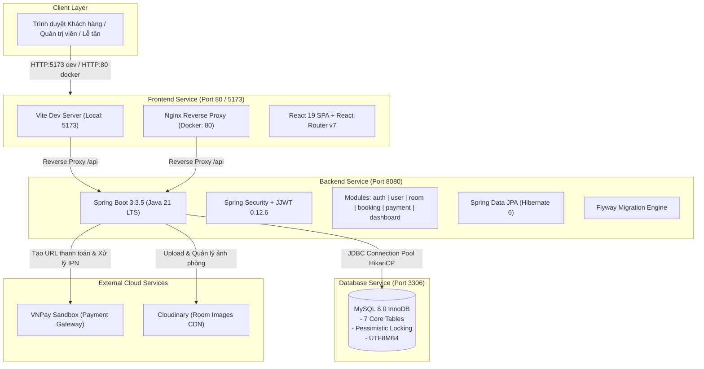

# 🏨 Hotel Booking System (HBS) - Enterprise MVP

[](https://github.com/Huidinne/Hotel-Booking-System_HBS/actions)


> **Hệ thống Đặt phòng Khách sạn & Quản lý Lưu trú Trực tuyến dành cho Khách sạn Độc lập (Independent Boutique Hotel)**  
> Dự án triển khai theo kiến trúc **Modular Monolith**, tuân thủ các quy tắc bảo mật doanh nghiệp, cơ chế chống **Overbooking** bằng Pessimistic Locking, tích hợp cổng thanh toán **VNPay Sandbox**, lưu trữ đa phương tiện qua **Cloudinary**, và tự động hóa quy trình CI/CD với **Docker** & **GitHub Actions**.

---

## 📑 Mục Lục
1. [Phân Tích Kiến Trúc Hệ Thống (DevOps & QA Overview)](#-phân-tích-kiến-trúc-hệ-thống-devops--qa-overview)
2. [Cấu Trúc Thư Mục Dự Án (Project Structure)](#-cấu-trúc-thư-mục-dự-án-project-structure)
3. [Yêu Cầu Môi Trường Tiền Đề (Prerequisites)](#-yêu-cầu-môi-trường-tiền-đề-prerequisites)
4. [Cấu Hình Biến Môi Trường (.env / application.yaml)](#-cấu-hình-biến-môi-trường-env--applicationyaml)
5. [Hướng Dẫn Khởi Chạy Chi Tiết Từ A Đến Z](#-hướng-dẫn-khởi-chạy-chi-tiết-từ-a-đến-z)
   - [Cách 1: Khởi chạy toàn bộ bằng Docker Compose (Khuyên dùng)](#cách-1-khởi-chạy-toàn-bộ-bằng-docker-compose-khuyên-dùng-cho-devops--qa--quick-demo)
   - [Cách 2: Khởi chạy môi trường phát triển cục bộ (Local Development)](#cách-2-khởi-chạy-từng-phần-cho-lập-trình-viên-local-development)
6. [Tài Khoản Mẫu & Dữ Liệu Khởi Tạo (Seed Accounts)](#-tài-khoản-mẫu--dữ-liệu-khởi-tạo-seed-accounts)
7. [Quy Trình Kiểm Thử & Đảm Bảo Chất Lượng (QA Testing Guide)](#-quy-trình-kiểm-thử--đảm-bảo-chất-lượng-qa-testing-guide)
8. [Xử Lý Sự Cố Thường Gặp (Troubleshooting & FAQs)](#-xử-lý-sự-cố-thường-gặp-troubleshooting--faqs)
9. [Quy Chuẩn Git & Tài Liệu Liên Quan](#-quy-chuẩn-git--tài-liệu-liên-quan)

---

## 🏛️ Phân Tích Kiến Trúc Hệ Thống (DevOps & QA Overview)

Hệ thống được thiết kế theo mô hình **Modular Monolith** phân tách rõ ràng giữa tầng hiển thị (Frontend SPA), tầng dịch vụ nghiệp vụ (Backend RESTful API), và tầng lưu trữ dữ liệu (Relational Database).



### 1. Chi tiết Backend (Spring Boot 3)
- **Framework & Phiên bản:** [Spring Boot](https://spring.io/projects/spring-boot) **`3.3.5`** (với `spring-boot-starter-web`, `spring-boot-starter-validation`, `spring-boot-devtools`).
- **Ngôn ngữ & Runtime:** **Java 21 LTS** (sử dụng Gradle Toolchain `JavaLanguageVersion.of(21)`).
- **Trình quản lý đóng gói:** Gradle 8.x/9.x thông qua bộ công cụ đính kèm `gradlew` (Linux/macOS) và `gradlew.bat` (Windows).
- **Bảo mật & Phân quyền:** `spring-boot-starter-security` kết hợp thư viện `io.jsonwebtoken:jjwt-api:0.12.6` (Access Token thời hạn 30 phút, Refresh Token thời hạn 7 ngày). Hỗ trợ kiểm soát truy cập dựa trên 3 vai trò: `ROLE_CUSTOMER`, `ROLE_RECEPTIONIST`, `ROLE_ADMIN`.
- **Giao tiếp CSDL & ORM:** `spring-boot-starter-data-jpa` (Hibernate 6), MySQL Connector/J (`com.mysql:mysql-connector-j`).
- **Tài liệu hóa API:** `org.springdoc:springdoc-openapi-starter-webmvc-ui:2.6.0` (Tự động sinh tài liệu OpenAPI 3 & Swagger UI trực quan tại `/swagger-ui.html`).
- **Lưu trữ hình ảnh:** `com.cloudinary:cloudinary-http44:1.36.0`.
- **Cơ chế Testing:** `spring-boot-starter-test`, `spring-security-test`, JUnit 5 Platform, và H2 in-memory database (`com.h2database:h2`) cấu hình độc lập tại `src/test/resources/application.yaml` để kiểm thử tự động không bị phụ thuộc vào môi trường ngoài.

### 2. Chi tiết Frontend (React 19 & Vite 8)
- **Thư viện UI cốt lõi:** **React `19.3.1`** và **React DOM `19.3.1`**.
- **Công cụ Build & Server phát triển:** **Vite `8.3.4`** với plugin chính thức `@vitejs/plugin-react: 6.1.2`. Cấu hình Reverse Proxy nội bộ tại `frontend/vite.config.js` để tự động điều hướng các request `/api` sang `http://localhost:8080`.
- **Điều hướng & Routing:** **React Router DOM `7.18.4`**.
- **Bộ Icon hiện đại:** `lucide-react: 1.60.0`.
- **Giao diện & Styling:** Vanilla CSS chuyên sâu kết hợp hệ thống CSS Variables chuẩn mực (`App.css`, `index.css`), hỗ trợ responsive toàn diện cho Mobile, Tablet và Desktop.
- **Tầng giao tiếp API (Client Service Layer):** Được định nghĩa tại `frontend/src/services/apiClient.ts` sử dụng native `fetch`, hỗ trợ gắn JWT Bearer Token tự động, bắt lỗi kết nối, unwrap định dạng `ApiResponse<T>`, và tự động ping kiểm tra trạng thái Backend qua endpoint `/api/v1/health`.
- **Linter & Kiểm tra chất lượng mã nguồn:** `oxlint: 1.88.0` kết hợp `typescript: 7.0.2`.

### 3. Chi tiết Database & Cơ chế Migration (MySQL 8.0)
- **Hệ quản trị CSDL:** **MySQL 8.0** (`image: mysql:8.0`), sử dụng engine **InnoDB** hỗ trợ Row-level Locking và Transaction ACID.
- **7 Bảng dữ liệu cốt lõi:**
  1. `users`: Tài khoản người dùng, mã hóa mật khẩu BCrypt, vai trò và trạng thái kích hoạt.
  2. `room_types`: Danh mục loại phòng (Sức chứa, đơn giá gốc theo đêm, tiện ích, mô tả).
  3. `room_type_images`: URL ảnh buồng phòng được lưu trữ trên Cloudinary.
  4. `rooms`: Phòng vật lý thực tế trong khách sạn (`room_number`, `floor`, trạng thái: `AVAILABLE`, `OCCUPIED`, `CLEANING`, `MAINTENANCE`).
  5. `bookings`: Đơn đặt phòng của khách (`booking_code`, khoảng ngày nhận/trả phòng, đơn giá snapshot, tiền đặt cọc 50%, trạng thái đơn, trạng thái thanh toán, thời hạn giữ phòng `hold_expires_at`, thông tin tài khoản ngân hàng khi hoàn cọc).
  6. `booking_rooms`: Bảng gán liên kết $N$ phòng vật lý cụ thể cho booking khi Lễ tân thực hiện thủ tục Check-in.
  7. `payment_transactions`: Lịch sử từng giao dịch (VNPay Sandbox / Tiền mặt), mã giao dịch nội bộ và `vnp_transaction_no` đảm bảo tính Idempotent chống xử lý lặp.
- **Cơ chế Khởi tạo & Đồng bộ (Flyway Migration):**
  - Dự án kích hoạt Flyway tự động (`spring.flyway.enabled=true`).
  - Toàn bộ script DDL schema và DML seed data được lưu trữ tại `backend/src/main/resources/db/migration/`:
    - `V1__init_schema.sql`: Khởi tạo toàn bộ cấu trúc 7 bảng, khóa ngoại, ràng buộc CHECK và Composite Index chống Overbooking.
    - `V2__seed_data.sql`: Nạp sẵn dữ liệu mẫu thực tế về loại phòng, danh sách phòng vật lý, các đơn đặt phòng mẫu và 3 tài khoản mặc định.
  - Thư mục `database/migrations/` được ánh xạ trực tiếp vào `/docker-entrypoint-initdb.d` trong `compose.yaml` để đảm bảo container MySQL độc lập cũng tự khởi tạo được dữ liệu ngay cả khi chưa bật Backend.

---

## 📁 Cấu Trúc Thư Mục Dự Án (Project Structure)

```text
Hotel-Booking-System_HBS/
├── .github/
│   └── workflows/
│       └── ci-cd.yaml             # Pipeline GitHub Actions: Build, Test Backend/Frontend, Deploy VPS
├── backend/                       # Module Backend Spring Boot 3
│   ├── gradle/wrapper/            # Bộ cài Gradle Wrapper
│   ├── src/
│   │   ├── main/
│   │   │   ├── java/org/example/backend/
│   │   │   │   ├── auth/          # Xác thực, JWT Provider, Security Filters
│   │   │   │   ├── booking/       # Đặt phòng, tính tiền cọc, hủy phòng, chính sách phạt
│   │   │   │   ├── common/        # Cấu hình chung (CORS, Cloudinary, VNPay, Exception Handler)
│   │   │   │   ├── controller/    # Health Check API & RESTful Endpoints
│   │   │   │   ├── dashboard/     # Thống kê doanh thu, tỷ lệ lấp đầy phòng cho Admin
│   │   │   │   ├── payment/       # Tích hợp VNPay URL generator & IPN Webhook handler
│   │   │   │   ├── room/          # Quản lý loại phòng và buồng phòng vật lý
│   │   │   │   ├── user/          # Quản lý hồ sơ tài khoản và phân quyền
│   │   │   │   └── BackendApplication.java # Main Application Runner
│   │   │   └── resources/
│   │   │       ├── application.yaml        # File cấu hình môi trường chính thức của Spring Boot
│   │   │       └── db/migration/           # Các script Flyway Migration (V1, V2)
│   │   └── test/                  # Bộ kiểm thử Unit & Integration Tests (sử dụng H2 Database)
│   ├── Dockerfile                 # Multi-stage Dockerfile cho Backend (JDK 21 Builder -> JRE 21 Runtime)
│   ├── build.gradle               # Khai báo thư viện & dependencies của Gradle
│   ├── gradlew / gradlew.bat      # Script thực thi Gradle Wrapper không cần cài Gradle trước
│   └── settings.gradle            # Cấu hình tên project Gradle
├── frontend/                      # Module Frontend React 19 + Vite 8
│   ├── public/                    # Tài nguyên tĩnh
│   ├── src/
│   │   ├── assets/                # Hình ảnh và media tĩnh
│   │   ├── components/            # Các UI components tái sử dụng (Navbar, Sidebar, Modals, Tables)
│   │   ├── context/               # React Contexts (AuthContext, ToastContext, ConfirmContext)
│   │   ├── mock/                  # Dữ liệu Mock dự phòng khi Backend chưa khởi động
│   │   ├── pages/                 # Giao diện Khách hàng, Lễ tân và Quản trị viên
│   │   ├── services/              # Tầng giao tiếp HTTP API (apiClient, auth, booking, room, payment)
│   │   ├── types/                 # Định nghĩa TypeScript Interfaces & Types
│   │   ├── App.css / index.css    # Hệ thống Stylesheet hiện đại & Responsive
│   │   ├── App.jsx                # Thiết lập Router và phân định quyền truy cập trang
│   │   └── main.jsx               # Điểm nhập của ứng dụng React
│   ├── Dockerfile                 # Multi-stage Dockerfile cho Frontend (Node 20 Builder -> Nginx Alpine)
│   ├── nginx.conf                 # Cấu hình máy chủ Nginx & Reverse Proxy chuyển tiếp /api
│   ├── package.json               # Khai báo dependencies Frontend
│   ├── tsconfig.json              # Cấu hình TypeScript compiler
│   └── vite.config.js             # Cấu hình Vite Dev Server & Local Proxy
├── database/
│   └── migrations/                # Bản sao các tệp SQL migration phục vụ Docker MySQL init
├── docs/
│   └── SRS.md                     # Tài liệu đặc tả yêu cầu kỹ thuật & nghiệp vụ chi tiết (SRS v2.1)
├── .env.example                   # Tệp mẫu cấu hình toàn bộ biến môi trường của hệ thống
├── .gitignore                     # Danh sách file và thư mục loại trừ không commit lên Git
├── compose.yaml                   # File Docker Compose hợp nhất 3 dịch vụ: DB, Backend, Frontend
├── Notes when working with Git.md # Quy định Git Flow và quy chuẩn Commit của nhóm
└── README.md                      # Tài liệu hướng dẫn cài đặt & vận hành này
```

---

## 💻 Yêu Cầu Môi Trường Tiền Đề (Prerequisites)

Trước khi bắt đầu, các thành viên trong nhóm cần đảm bảo máy tính đã cài đặt các công cụ sau:

| Công cụ | Phiên bản yêu cầu | Mục đích sử dụng | Kiểm tra phiên bản bằng lệnh |
| :--- | :--- | :--- | :--- |
| **Git** | `2.30+` | Quản lý mã nguồn & phân nhánh | `git --version` |
| **Docker & Docker Compose** | Docker `24.0+`, Compose `v2+` | Chạy toàn bộ hệ thống hoặc chạy MySQL container | `docker --version`<br>`docker compose version` |
| **Java Development Kit (JDK)** | **Java 21 LTS** (Khuyên dùng Eclipse Temurin hoặc OpenJDK) | Biên dịch và chạy Backend Spring Boot | `java -version` |
| **Node.js & npm** | Node.js `20.x` hoặc `22.x` (LTS), npm `10+` | Cài đặt thư viện và chạy Frontend React | `node -v`<br>`npm -v` |
| **MySQL Client (Tùy chọn)** | DBeaver / Navicat / MySQL Workbench | Kiểm tra dữ liệu và query trực tiếp CSDL | - |

> [!TIP]
> **Không cần cài đặt sẵn Gradle:** Dự án đã tích hợp sẵn Gradle Wrapper (`gradlew` / `gradlew.bat`), hệ thống sẽ tự động tải phiên bản Gradle tương thích khi bạn chạy lệnh đầu tiên.

---

## ⚙️ Cấu Hình Biến Môi Trường (.env / application.yaml)

Dự án áp dụng nguyên tắc quản lý cấu hình thông qua **Biến môi trường (Environment Variables)** để đảm bảo tính an toàn, không lộ secret key và dễ dàng triển khai giữa các môi trường (Local, Test, Staging, Production).

### 1. Tạo tệp `.env` tại thư mục gốc
Tại thư mục gốc của repository, sao chép tệp mẫu `.env.example` thành `.env`:

```bash
# Trên Linux / macOS / Git Bash:
cp .env.example .env

# Trên Windows Command Prompt:
copy .env.example .env

# Trên Windows PowerShell:
Copy-Item .env.example .env
```

### 2. Bảng phân tích chi tiết các biến môi trường

| Tên biến môi trường | Giá trị mặc định (Local Dev) | Mô tả chi tiết & Hướng dẫn cấu hình |
| :--- | :--- | :--- |
| **CẤU HÌNH CƠ SỞ DỮ LIỆU (MYSQL)** | | |
| `MYSQL_DATABASE` | `hotel_db` | Tên cơ sở dữ liệu chính của hệ thống. |
| `MYSQL_USER` | `hotel_user` | Tên tài khoản người dùng database được cấp quyền làm việc với `hotel_db`. |
| `MYSQL_PASSWORD` | `hotel_password_secure` | Mật khẩu của `hotel_user`. |
| `DB_ROOT_PASSWORD` | `root_password_secure` | Mật khẩu tài khoản `root` của MySQL. |
| `DB_HOST_PORT` | `3306` | Cổng MySQL mở ra ngoài máy host. *(Lưu ý: Nếu máy bạn đã cài XAMPP/MySQL chạy cổng 3306, hãy đổi thành `3307`)*. |
| `SPRING_DATASOURCE_URL` | Xem bên dưới | Chuỗi kết nối JDBC cho Spring Boot.<br>• Khi chạy **Docker Compose**: `jdbc:mysql://mysql-db:3306/hotel_db?useSSL=false&allowPublicKeyRetrieval=true&serverTimezone=Asia/Ho_Chi_Minh&characterEncoding=UTF-8`<br>• Khi chạy **Backend Local**: `jdbc:mysql://localhost:3306/hotel_db?useSSL=false&allowPublicKeyRetrieval=true&serverTimezone=Asia/Ho_Chi_Minh&characterEncoding=UTF-8` |
| `SPRING_DATASOURCE_USERNAME` | `hotel_user` | Username để Spring Boot đăng nhập vào MySQL. |
| `SPRING_DATASOURCE_PASSWORD` | `hotel_password_secure` | Mật khẩu để Spring Boot đăng nhập vào MySQL. |
| **CẤU HÌNH BACKEND & JWT** | | |
| `BACKEND_HOST_PORT` | `8080` | Cổng HTTP mở ra máy Host cho Backend API. |
| `SERVER_PORT` | `8080` | Cổng lắng nghe nội bộ của Tomcat Spring Boot. |
| `JWT_SECRET` | Chuỗi 32+ bytes | Khóa bí mật dùng để ký và giải mã JWT token (tối thiểu 256 bits). Đã có sẵn giá trị mặc định cho local dev. |
| `JWT_ACCESS_EXPIRATION_MS` | `1800000` | Thời hạn hiệu lực của Access Token (1,800,000 ms = 30 phút). |
| `JWT_REFRESH_EXPIRATION_MS`| `604800000` | Thời hạn hiệu lực của Refresh Token (604,800,000 ms = 7 ngày). |
| **DỊCH VỤ NGOÀI (CLOUDINARY & VNPAY)** | | |
| `CLOUDINARY_CLOUD_NAME` | `demo_cloud` | Tên tài khoản Cloudinary dùng lưu trữ ảnh phòng thực tế. |
| `CLOUDINARY_API_KEY` | `demo_key` | API Key Cloudinary. |
| `CLOUDINARY_API_SECRET` | `demo_secret` | API Secret Cloudinary. |
| `VNPAY_TMN_CODE` | `DEMO_TMN` | Mã Terminal Website do VNPay Sandbox cấp khi đăng ký tài khoản thử nghiệm. |
| `VNPAY_HASH_SECRET` | `DEMO_HASH_SECRET` | Khóa bí mật checksum SHA512 do VNPay cung cấp để xác thực giao dịch. |
| `VNPAY_PAY_URL` | `https://sandbox.vnpayment.vn/paymentv2/vpcpay.html` | Cổng thanh toán trực tuyến môi trường Sandbox của VNPay. |
| `VNPAY_RETURN_URL` | `http://localhost:5173/payment/vnpay-return` | Đường dẫn Frontend đón kết quả điều hướng trở lại sau khi khách thanh toán. |
| **CẤU HÌNH FRONTEND** | | |
| `FRONTEND_HOST_PORT` | `80` | Cổng HTTP Nginx khi chạy Frontend trong container Docker. |
| `VITE_API_BASE_URL` | `http://localhost:8080/api/v1` | URL gốc của Backend REST API để Frontend gọi trực tiếp khi dev. |

> [!IMPORTANT]
> **Cơ chế nạp cấu hình của Backend (`application.yaml`):**  
> Tệp [`backend/src/main/resources/application.yaml`](backend/src/main/resources/application.yaml) đã được cấu hình sẵn cú pháp fallback dạng `${TÊN_BIẾN:giá_trị_mặc_định}`. Do đó, khi bạn phát triển ở máy local và không truyền biến môi trường nào, Backend sẽ **tự động lấy giá trị mặc định kết nối tới `localhost:3306` với user `hotel_user` và pass `hotel_password_secure`**.

---

## 🚀 Hướng Dẫn Khởi Chạy Chi Tiết Từ A Đến Z

### 📋 Bước 0: Clone Repository & Chuẩn Bị Mã Nguồn
Mở terminal trên máy tính của bạn và thực hiện lệnh:

```bash
# 1. Clone repository về máy cá nhân
git clone https://github.com/Huidinne/Hotel-Booking-System_HBS.git

# 2. Di chuyển vào thư mục dự án
cd Hotel-Booking-System_HBS

# 3. Tạo file .env từ file mẫu
cp .env.example .env
```

---

### Cách 1: Khởi Chạy Toàn Bộ Bằng Docker Compose (Khuyên dùng cho DevOps / QA / Quick Demo)

Phương pháp này giúp dựng toàn bộ môi trường đầy đủ gồm: **MySQL Database 8.0 + Spring Boot Backend + React Nginx Frontend** chỉ với 1 câu lệnh duy nhất mà không cần cài đặt JDK hay Node.js trên máy cá nhân.

#### 1. Khởi chạy tất cả dịch vụ
Tại thư mục gốc `Hotel-Booking-System_HBS/`, chạy lệnh:

```bash
docker compose up -d --build
```

#### 2. Kiểm tra trạng thái hoạt động
```bash
docker compose ps
```
Bạn sẽ thấy 3 container hiển thị trạng thái `Up` (hoặc `healthy` đối với `mysql-db`):
- `hotel-mysql`: Cổng `0.0.0.0:3306->3306/tcp`
- `hotel-backend`: Cổng `0.0.0.0:8080->8080/tcp`
- `hotel-frontend`: Cổng `0.0.0.0:80->80/tcp`

#### 3. Theo dõi log thời gian thực khi cần kiểm tra
```bash
# Xem log toàn bộ hệ thống
docker compose logs -f

# Xem log riêng Backend để theo dõi Flyway migration & khởi động Spring Boot
docker compose logs -f backend

# Xem log riêng Database
docker compose logs -f mysql-db
```

#### 4. Truy cập các dịch vụ
- 🌐 **Frontend Web App (Giao diện người dùng & Quản trị):** [http://localhost](http://localhost)
- 🔌 **Backend API Health Check:** [http://localhost:8080/api/v1/health](http://localhost:8080/api/v1/health)
- 📖 **Swagger UI / API Documentation:** [http://localhost:8080/swagger-ui.html](http://localhost:8080/swagger-ui.html)
- 🗄️ **MySQL Database:** Kết nối qua `localhost:3306` (User: `hotel_user`, Pass: `hotel_password_secure`, Database: `hotel_db`).

#### 5. Dừng hoặc Reset hệ thống
```bash
# Dừng tất cả container (dữ liệu CSDL vẫn được lưu giữ an toàn trong Docker Volume)
docker compose down

# Dừng và XÓA SẠCH toàn bộ dữ liệu CSDL để nạp lại từ đầu
docker compose down -v
```

---

### Cách 2: Khởi Chạy Từng Phần Cho Lập Trình Viên (Local Development)

Phương pháp này dành cho các thành viên Backend và Frontend cần debug trực tiếp, chạy hot reload hoặc sửa code liên tục.

#### 📍 Bước 1: Khởi chạy Cơ sở Dữ liệu MySQL

Bạn có thể chọn 1 trong 2 cách sau để có MySQL Database:

##### Lựa chọn A (Tiện lợi nhất): Chạy riêng container MySQL qua Docker
Tại thư mục gốc, chỉ cần chạy đúng service database:
```bash
docker compose up -d mysql-db
```
*Container sẽ tự động chạy ngầm, tạo user `hotel_user`, password `hotel_password_secure` và database `hotel_db`.*

##### Lựa chọn B: Sử dụng MySQL đã cài sẵn trên máy (hoặc qua XAMPP)
Nếu dùng MySQL local, hãy mở công cụ quản lý MySQL (CMD, Workbench, DBeaver) và chạy đoạn lệnh sau để chuẩn bị database và phân quyền:
```sql
CREATE DATABASE IF NOT EXISTS hotel_db CHARACTER SET utf8mb4 COLLATE utf8mb4_unicode_ci;
CREATE USER IF NOT EXISTS 'hotel_user'@'%' IDENTIFIED BY 'hotel_password_secure';
GRANT ALL PRIVILEGES ON hotel_db.* TO 'hotel_user'@'%';
FLUSH PRIVILEGES;
```

---

#### 📍 Bước 2: Cài đặt Dependencies & Khởi chạy Backend (Spring Boot)

Yêu cầu: Máy đã có **Java 21 LTS** (`java -version`).

1. Mở cửa sổ Terminal thứ nhất và di chuyển vào thư mục `backend`:
   ```bash
   cd backend
   ```

2. Cấp quyền thực thi cho Gradle Wrapper (chỉ cần làm 1 lần trên Linux/macOS):
   ```bash
   chmod +x gradlew
   ```

3. Khởi chạy ứng dụng Spring Boot:
   ```bash
   # Trên Linux / macOS / Git Bash:
   ./gradlew bootRun

   # Trên Windows PowerShell / Command Prompt:
   .\gradlew.bat bootRun
   ```

4. **Kiểm tra Backend:**
   - Khi terminal xuất hiện dòng chữ `Started BackendApplication in ... seconds`, ứng dụng đã sẵn sàng.
   - Flyway sẽ tự động quét thư mục `db/migration/`, tạo đủ 7 bảng và nạp toàn bộ dữ liệu mẫu (Seed Data).
   - Kiểm tra API bằng trình duyệt: [http://localhost:8080/api/v1/health](http://localhost:8080/api/v1/health) (nhận kết quả JSON `{"status":"UP", ...}`).
   - Xem danh sách API: [http://localhost:8080/swagger-ui.html](http://localhost:8080/swagger-ui.html).

5. **Chạy Unit & Integration Tests của Backend:**
   ```bash
   # Linux / macOS:
   ./gradlew test

   # Windows:
   .\gradlew.bat test
   ```
   *(Bộ test sử dụng H2 in-memory DB nên có thể chạy độc lập ngay cả khi tắt MySQL).*

---

#### 📍 Bước 3: Cài đặt Dependencies & Khởi chạy Frontend (React + Vite)

Yêu cầu: Máy đã có **Node.js 20+** và **npm**.

1. Mở cửa sổ Terminal thứ hai và di chuyển vào thư mục `frontend`:
   ```bash
   cd frontend
   ```

2. Cài đặt các thư viện dependencies:
   ```bash
   npm install
   ```
   *(Nếu trên Windows PowerShell gặp lỗi bảo mật `File npm.ps1 cannot be loaded...`, vui lòng xem mục [Xử Lý Sự Cố](#-xử-lý-sự-cố-thường-gặp-troubleshooting--faqs) bên dưới hoặc dùng lệnh `npm.cmd install`).*

3. Khởi chạy Vite Dev Server:
   ```bash
   npm run dev
   ```

4. **Truy cập ứng dụng:**
   - Giao diện người dùng sẽ chạy tại: **[http://localhost:5173](http://localhost:5173)**
   - Mọi request xuất phát từ Frontend tới đường dẫn `/api/...` sẽ tự động được Vite Proxy chuyển hướng ngầm sang Backend tại `http://localhost:8080`.

5. **Kiểm tra mã nguồn & Build kiểm thử Frontend:**
   ```bash
   # Chạy linter kiểm tra cú pháp và chất lượng code
   npm run lint

   # Thử build bản đóng gói sản phẩm (Production bundle)
   npm run build
   ```

---

## 🔑 Tài Khoản Mẫu & Dữ Liệu Khởi Tạo (Seed Accounts)

Sau khi hệ thống khởi chạy và Flyway thực hiện xong tệp `V2__seed_data.sql`, CSDL đã có sẵn 3 tài khoản tương ứng với 3 phân quyền phục vụ việc kiểm thử QA:

| Vai trò (Role) | Email đăng nhập | Mật khẩu mặc định | Mục đích kiểm thử & Quyền hạn |
| :--- | :--- | :--- | :--- |
| **Admin** | `admin@hotel.com` | `Password@123` | • Quản trị danh mục loại phòng, thêm/sửa/xóa buồng phòng vật lý.<br>• Xem thống kê Dashboard: Doanh thu, tỷ lệ lấp đầy, biểu đồ tháng. |
| **Receptionist** | `receptionist@hotel.com` | `Password@123` | • Danh sách Booking: Xác nhận đơn (`CONFIRMED`).<br>• Làm thủ tục Check-in: Gán $N$ phòng vật lý cụ thể còn trống.<br>• Làm thủ tục Check-out: Trả phòng, chuyển trạng thái dọn dẹp (`CLEANING`).<br>• Quản lý duyệt hoàn tiền đặt cọc cho khách. |
| **Customer** | `customer@gmail.com` | `Password@123` | • Tìm kiếm loại phòng theo ngày lưu trú.<br>• Đặt phòng và thanh toán cọc 50% qua VNPay Sandbox.<br>• Xem lịch sử đặt phòng trong `My Bookings`, gửi yêu cầu hủy phòng và nhận hoàn tiền theo quy định. |

---

## 🧪 Quy Trình Kiểm Thử & Đảm Bảo Chất Lượng (QA Testing Guide)

Dành cho Tester / QA khi thực hiện nghiệm thu và kiểm thử tự động / thủ công:

### 1. Kiểm tra tính toàn vẹn của mã nguồn (Automated Tests)
- **Backend Test Suite:** Chạy `cd backend && ./gradlew test` (hoặc `.\gradlew.bat test`). Kiểm tra 100% test case pass, bao gồm:
  - Auth test: Đăng ký, đăng nhập, sinh JWT token hợp lệ, từ chối token giả mạo.
  - Booking & Concurrency test: Kiểm tra tính toán giá tiền, 50% cọc, và chính sách phạt hủy phòng.
  - Health endpoint test: Đảm bảo Spring Boot context nạp thành công.
- **Frontend Linter:** Chạy `cd frontend && npm run lint` để kiểm tra toàn bộ lỗi cú pháp JavaScript/React/TypeScript.

### 2. Kịch bản kiểm thử luồng nghiệp vụ chính (End-to-End Happy Path)
1. **Tìm & Đặt phòng:**
   - Dùng tài khoản `customer@gmail.com` đăng nhập tại `/login`.
   - Vào mục danh sách phòng `/rooms`, chọn khoảng ngày nhận/trả phòng.
   - Chọn loại phòng mong muốn, nhập số lượng phòng và ấn **Đặt phòng**.
2. **Thanh toán cọc VNPay Sandbox:**
   - Tại trang thanh toán, chọn cổng **VNPay**, hệ thống chuyển tiếp sang trang Sandbox của VNPay.
   - Sử dụng thẻ demo do VNPay cung cấp (Ngân hàng NCB, Số thẻ: `9704198526191432198`, Tên: `NGUYEN VAN A`, Ngày phát hành: `07/15`, OTP: `123456`).
   - Sau khi thanh toán thành công, hệ thống chuyển về trang `/payment/vnpay-return` và trạng thái thanh toán chuyển sang `PARTIALLY_PAID` (Đã cọc 50%).
3. **Lễ tân Check-in & Gán phòng vật lý:**
   - Đăng nhập tài khoản `receptionist@hotel.com`.
   - Vào mục `/receptionist/bookings`, tìm đơn đặt phòng vừa tạo.
   - Nhấn **Xác nhận đơn** -> Nhấn **Check-in**, màn hình hiển thị danh sách các phòng vật lý đang `AVAILABLE` tương ứng với loại phòng đó.
   - Chọn phòng và xác nhận gán phòng. Trạng thái phòng chuyển sang `OCCUPIED`.
4. **Lễ tân Check-out:**
   - Thực hiện thủ tục Check-out và thanh toán 50% tiền phòng còn lại bằng tiền mặt.
   - Trạng thái phòng tự động chuyển sang `CLEANING` (Cần dọn dẹp).
5. **Admin đối soát:**
   - Đăng nhập `admin@hotel.com`, vào `/admin/dashboard` để kiểm tra doanh thu ghi nhận đúng số liệu.

---

## 🛠️ Xử Lý Sự Cố Thường Gặp (Troubleshooting & FAQs)

### ❓ 1. Lỗi PowerShell: `npm.ps1 cannot be loaded because running scripts is disabled on this system`
- **Nguyên nhân:** Chính sách Execution Policy mặc định của Windows PowerShell chặn thực thi script `.ps1`.
- **Cách khắc phục:** Có 2 cách:
  - **Cách 1 (Nhanh nhất):** Thay vì gõ `npm ...`, hãy gõ `npm.cmd ...` (ví dụ: `npm.cmd install`, `npm.cmd run dev`).
  - **Cách 2:** Mở PowerShell với quyền Administrator và cho phép chạy script cho user hiện tại:
    ```powershell
    Set-ExecutionPolicy -Scope CurrentUser -ExecutionPolicy RemoteSigned
    ```

### ❓ 2. Lỗi xung đột cổng (Port already in use: 3306, 8080, 80, 5173)
- **Nếu trùng cổng MySQL 3306 (do máy bạn đang bật sẵn MySQL/XAMPP/MariaDB):**
  - Mở tệp `.env`, sửa dòng `DB_HOST_PORT=3306` thành `DB_HOST_PORT=3307`.
  - Nếu chạy backend local, đổi chuỗi kết nối trong `application.yaml` sang cổng `3307`.
- **Nếu trùng cổng Backend 8080:**
  - Sửa `BACKEND_HOST_PORT=8081` trong `.env` hoặc truyền `SERVER_PORT=8081` khi chạy `./gradlew bootRun --args='--server.port=8081'`.
- **Nếu trùng cổng Frontend 80 (khi chạy Docker):**
  - Đổi `FRONTEND_HOST_PORT=8088` trong `.env`, sau đó truy cập web tại `http://localhost:8088`.

### ❓ 3. Lỗi Java: `Unsupported class file major version` hoặc yêu cầu Java 21
- **Nguyên nhân:** Dự án được cấu hình bằng Java 21 toolchain. Nếu máy cài Java 11 hoặc 17, Gradle sẽ cố tải JDK 21 hoặc báo lỗi nếu không có mạng.
- **Cách khắc phục:** Cài đặt đúng [OpenJDK 21 / Eclipse Temurin JDK 21](https://adoptium.net/temurin/releases/?version=21), sau đó thiết lập biến môi trường `JAVA_HOME` trỏ tới thư mục cài đặt JDK 21.

### ❓ 4. Lỗi kết nối CSDL: `Access denied for user 'hotel_user'@'...'` hoặc `Unknown database 'hotel_db'`
- **Cách khắc phục:**
  - Nếu chạy bằng Docker, chạy lệnh `docker compose down -v` rồi `docker compose up -d mysql-db` để Docker xóa sạch volume cũ và khởi tạo lại đúng mật khẩu từ `.env`.
  - Đảm bảo mật khẩu trong `.env` và trong `application.yaml` khớp nhau (`hotel_password_secure`).

### ❓ 5. Làm sao để reset sạch dữ liệu mẫu về trạng thái ban đầu?
Chỉ cần thực hiện lệnh sau:
```bash
docker compose down -v
docker compose up -d
```
Lệnh `-v` (volume) sẽ xóa volume `mysql_data`, khi khởi động lại, Flyway sẽ tự động chạy lại từ đầu cả 2 tệp `V1__init_schema.sql` và `V2__seed_data.sql`.

---

## 📜 Quy Chuẩn Git & Tài Liệu Liên Quan

1. **Tài liệu Đặc tả Yêu cầu Phần mềm (SRS v2.1):** Chi tiết nghiệp vụ, công thức phạt cọc 4 bậc mốc 14:00, Cronjob No-Show, và đặc tả API DTO Contract tại **[docs/SRS.md](docs/SRS.md)**.
2. **Quy tắc bảo mật:** **Tuyệt đối KHÔNG commit file `.env` chứa mật khẩu thật hoặc các Secret Key lên GitHub.** Mọi đóng góp phải thông qua Pull Request và được review trước khi merge vào nhánh `main` hoặc `dev`.
