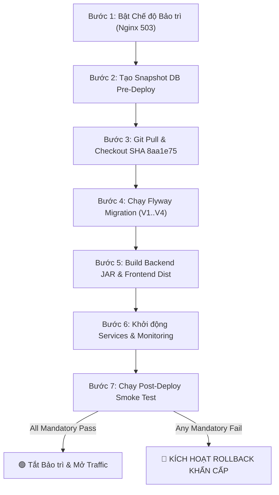
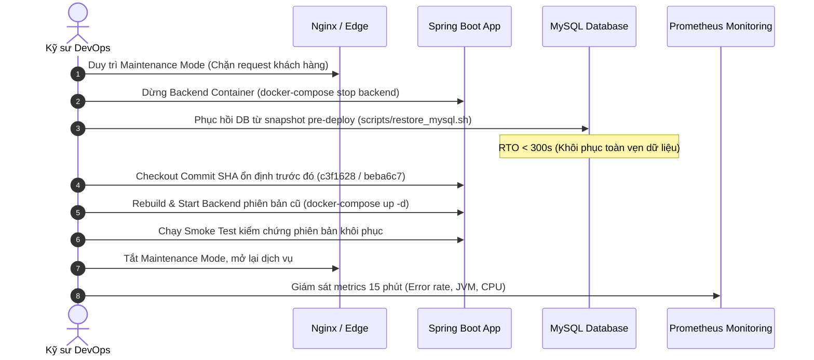

# 🚀 Bảng Kiểm Soát Phát Hành & Kế Hoạch Rollback (Release Checklist & SOP)

> **Mã công việc:** Task `[SP3-1113-TRUNG]`  
> **Người thực hiện:** Kỹ sư QA & DevOps — Nguyễn Việt Trung (`Vtrung_Tester`)  
> **Ngày lập checklist:** `13/11/2026`  
> **Phiên bản phát hành:** Sprint 3 Release Candidate (`HBS-RC-Sprint3`)  
> **Nhánh Git:** `Vtrung_Tester` (đồng bộ nhánh `develop` tại commit `8aa1e75`)  
> **Git Commit SHA nghiệm thu:** `8aa1e75` (`git rev-parse --short HEAD`)  
> **Môi trường mục tiêu:** Staging / VPS Production (`221.121.4.97`) & Local Simulation

---

## 📌 1. Mục Đích & Nguyên Tắc Vận Hành

Tài liệu này đóng vai trò **Cổng Kiểm Soát Chất Lượng (Release Quality Gate)** và Quy trình Vận hành Tiêu chuẩn (SOP) trước, trong và sau khi triển khai phiên bản Sprint 3 của hệ thống **Hotel Booking System (HBS)**.

### Nguyên Tắc Bất Di Bất Dịch (Zero-Blocker Release Policy)
1. **100% Ca Bắt buộc Đạt Chuẩn:** Bản phát hành chỉ được cấp phép lên Production khi **toàn bộ 39 ca kiểm thử Bắt buộc (Mandatory E2E)** trong kịch bản kiểm thử đạt trạng thái `PASS`.
2. **Không có Lỗi Critical/P1 Còn Mở:** Nghiêm cấm phát hành nếu còn tồn tại bất kỳ lỗi nghiêm trọng nào làm sập luồng nghiệp vụ cốt lõi (đặc biệt là lỗi Check-out, Thanh toán, Hủy phòng hoàn cọc hoặc Sổ Cái kế toán).
3. **Bắt Buộc Sao Lưu Trước Triển Khai:** Mọi hành động deploy có can thiệp cơ sở dữ liệu đều phải tạo bản snapshot sao lưu an toàn và xác minh tính khôi phục trước khi áp dụng migrations.
4. **Cơ Chế Rollback Trong 5 Phút:** Nếu phát sinh sự cố sau deploy, quy trình Rollback phải được kích hoạt ngay lập tức với mục tiêu RTO < 300 giây (đã được diễn tập thành công).

---

## 📋 2. Bảng Kiểm Tra Trước Phát Hành (Pre-Release Quality Checks)

| STT | Hạng mục kiểm tra | Tiêu chuẩn nghiệm thu | Công cụ / Lệnh kiểm tra | Trạng thái | Người xác nhận |
| :---: | :--- | :--- | :--- | :---: | :--- |
| **1** | **Xác minh Commit SHA** | Khớp chính xác commit SHA đã qua review (`8aa1e75`), sạch working tree | `git rev-parse --short HEAD`<br>`git status` | 🟢 **PASSED** | Trung (QA/DevOps) |
| **2** | **Frontend CI Build & Lint** | Lint không có lỗi, Typecheck pass, build bundle `dist/` thành công | `npm --prefix frontend run lint`<br>`npm --prefix frontend run build` | 🟢 **PASSED** | Yến (devFE) / CI |
| **3** | **Backend Unit & Integration Tests** | 100% test cases backend pass xanh (33 suites, 242 tests, 0 failures, 0 errors) | `./backend/gradlew.bat test --no-daemon` | 🟢 **PASSED** | Đức Anh / Trung |
| **4** | **Docker & Monitoring Validation** | Cấu hình Docker Compose và Prometheus hợp lệ, cú pháp chuẩn | `docker-compose -f docker-compose.yml -f docker-compose.monitoring.yml config -q` | 🟢 **PASSED** | Trung (QA/DevOps) |
| **5** | **Bảo mật & Bí mật (Secrets)** | Không lộ credentials thật, pass token, SSH key trên repository | Quét `application.yaml`, scripts, commit history | 🟢 **PASSED** | Trung (QA/DevOps) |
| **6** | **Pre-Deploy Database Backup** | Đã tạo snapshot dữ liệu `hotel_db` trước khi deploy, SHA256 checksum khớp | `bash scripts/backup_mysql.sh pre_deploy_8aa1e75` | 🟢 **READY** | Trung (QA/DevOps) |
| **7** | **Diễn tập Phục hồi (DR Readiness)** | Kịch bản restore đã được diễn tập thành công, RTO < 300s, không lỗi khóa ngoại | `bash scripts/test_backup_restore.sh --skip-stress` | 🟢 **VERIFIED** | Trung (QA/DevOps) |

---

## 🏗️ 3. Quy Trình Triển Khai Tiêu Chuẩn (Standard Deployment Procedure)

Quy trình 6 bước áp dụng cho môi trường Staging / VPS Production (`221.121.4.97`):



### Chi tiết các bước thực hiện:

#### Bước 1: Kích hoạt Chế độ Bảo trì (Maintenance Mode)
Chuyển hướng người dùng tạm thời sang trang bảo trì thân thiện, ngăn chặn phát sinh giao dịch mới trong lúc update:
```bash
# Trên Nginx Reverse Proxy
sudo cp /etc/nginx/conf.d/maintenance.conf.disabled /etc/nginx/conf.d/maintenance.conf
sudo nginx -s reload
```

#### Bước 2: Tạo Snapshot Sao Lưu Cơ Sở Dữ Liệu
Chạy script sao lưu tự động tạo bản lưu trữ định danh theo commit SHA:
```bash
bash scripts/backup_mysql.sh "pre_deploy_8aa1e75"
# Kiểm tra file đã tạo trong backups/
ls -lh backups/hotel_db_pre_deploy_8aa1e75_*.sql.gz
```

#### Bước 3: Đồng bộ Mã nguồn & Kiểm tra Commit
```bash
git fetch origin
git checkout 8aa1e75
git rev-parse --short HEAD  # Phải in ra đúng: 8aa1e75
```

#### Bước 4: Áp dụng Cơ Sở Dữ Liệu Migrations (Flyway)
Kiểm tra và thực thi các migrations mới nhất (`V4__add_payment_ledger_fields.sql`):
```bash
# Backend tự động chạy khi khởi động hoặc chạy qua Gradle Flyway plugin:
cd backend && ./gradlew flywayMigrate
# Truy vấn xác minh schema_version:
# mysql -u root -p hotel_db -e "SELECT version, description, success FROM flyway_schema_history;"
```

#### Bước 5: Build Ứng Dụng Backend & Frontend
```bash
# Build Backend Spring Boot executable JAR
cd backend && ./gradlew bootJar -x test
# Build Frontend React Production Bundle
cd ../frontend && npm install --frozen-lockfile && npm run build
```

#### Bước 6: Khởi động Stack Dịch Vụ & Prometheus Monitoring
```bash
cd ..
docker-compose -f docker-compose.yml -f docker-compose.monitoring.yml up -d --remove-orphans
# Kiểm tra sức khỏe container
docker-compose ps
```

---

## 🚨 4. Quy Trình Phục Hồi Khẩn Cấp (Emergency Rollback Plan)

### 4.1. Điều Kiện Kích Hoạt Rollback Ngay Lập Tức (Rollback Triggers)
Người phụ trách Release **BẮT BUỘC** kích hoạt Rollback khi gặp bất kỳ điều kiện nào sau đây:
1. **Lỗi Nghiêm trọng Cơ sở dữ liệu:** Flyway migration thất bại, báo lỗi cú pháp hoặc làm hỏng dữ liệu existing.
2. **Backend Không Khởi Động:** Container Backend crash loop, không thể binding port `8080`, hoặc `/actuator/health` không đạt `UP` sau 3 phút.
3. **Thất Bại Cổng Kiểm Soát (Release Gate Blocked):** `scripts/smoke_test.sh` phát hiện ít nhất **1 ca kiểm thử Bắt buộc (Mandatory) thất bại** (exit code `1`).
4. **Lỗi Rò Rỉ Dòng Tiền / Check-out 500:** Phát hiện lỗi `HTTP 500` khi khách hàng check-out thanh toán tại quầy hoặc sai lệch số dư Sổ Cái (`BUG-SP3-01`).

### 4.2. Các Bước Thực Hiện Rollback Từng Phút (SOP Rollback)



1. **Phút 00:00 - 01:00 (Cô lập hệ thống):**
   - Giữ nguyên Maintenance Page trên Nginx để người dùng không gửi thêm request lỗi.
   - Dừng service Backend mới đang bị lỗi:
     ```bash
     docker-compose stop backend
     ```
2. **Phút 01:00 - 03:30 (Khôi phục Cơ sở dữ liệu):**
   - Kích hoạt khôi phục cơ sở dữ liệu về bản snapshot pre-deploy bằng script đã được diễn tập:
     ```bash
     bash scripts/restore_mysql.sh "backups/hotel_db_pre_deploy_8aa1e75_*.sql.gz"
     ```
   - Xác minh toàn vẹn khóa ngoại và số lượng bản ghi:
     ```bash
     mysql -u hotel_user -p hotel_db -e "SELECT COUNT(*) FROM bookings; SELECT COUNT(*) FROM payment_transactions;"
     ```
3. **Phút 03:30 - 05:00 (Hoàn nguyên Mã nguồn & Khởi động lại):**
   - Checkout về Commit SHA ổn định được phê duyệt gần nhất (ví dụ `c3f1628` hoặc `beba6c7`):
     ```bash
     git checkout c3f1628
     ```
   - Khởi động lại stack dịch vụ cũ:
     ```bash
     docker-compose up -d backend frontend
     ```
4. **Phút 05:00 - 06:30 (Kiểm tra Hậu Khôi phục & Mở lại dịch vụ):**
   - Kiểm tra Actuator Health: `curl -f http://localhost:8080/actuator/health`.
   - Chạy smoke test nhanh phiên bản khôi phục: `bash scripts/smoke_test.sh http://localhost:8080`.
   - Khi tất cả đều xanh, tắt trang bảo trì Nginx và mở lại lưu lượng cho khách hàng.
5. **Hậu Rollback (Post-Mortem & Phân tích RCA):**
   - Tổ chức họp khẩn trong vòng 2 giờ với Dev Backend (`Ducanh_devBE`, `thanh_devBE`) để phân tích nguyên nhân gốc.
   - Yêu cầu lập bản vá Hotfix trên branch fix riêng và retest trên môi trường cô lập trước khi xin cấp phép release lại.

---

## 🔍 5. Bảng Nghiệm Thu Sau Triển Khai (Post-Deployment Verification)

| STT | Luồng kiểm tra sau Deploy | Mục tiêu xác minh | Lệnh / Endpoint kiểm tra | Kết quả mong đợi |
| :---: | :--- | :--- | :--- | :---: |
| **1** | **Actuator Healthcheck** | Ứng dụng Backend sống và kết nối MySQL ổn định | `curl -f http://221.121.4.97:8080/actuator/health` | `{"status":"UP"}` |
| **2** | **Prometheus Internal Scrape** | Endpoint `/actuator/prometheus` nội bộ được scrape đều đặn 15s | `curl -s http://127.0.0.1:9090/api/v1/targets` | `state: "up"` |
| **3** | **Auth & User Session** | Đăng ký, đăng nhập cấp JWT, xác thực `GET /me` | `POST /api/v1/auth/login` | HTTP 200, JWT valid |
| **4** | **Tra cứu Phòng & Timeline** | Trả về 3 loại phòng, sơ đồ PMS hiển thị đủ 10 phòng | `GET /api/v1/room-types`<br>`GET /api/v1/receptionist/rooms/timeline` | HTTP 200 |
| **5** | **Đặt phòng Toàn trình (Full Flow)** | Chat quote/draft -> Confirm -> VNPay IPN -> PDF -> Email | `POST /chat/message`<br>`POST /bookings/drafts/...` | HTTP 200, PDF > 30KB |
| **6** | **Quy trình Check-in PMS** | Lễ tân check-in gán phòng vật lý thành công | `POST /api/v1/receptionist/bookings/{id}/check-in` | HTTP 200, room `OCCUPIED` |
| **7** | **Quy trình Check-out & Dọn phòng** | Tất toán phần tiền còn lại, chuyển `CLEANING` -> `AVAILABLE` | `POST /api/v1/receptionist/bookings/{id}/check-out` | HTTP 200, room `CLEANING` |
| **8** | **Hủy phòng & Hoàn cọc (Refund)** | Hủy >= 24h hoàn 100% cọc -> `REFUND_PENDING` -> `REFUNDED` | `POST /api/v1/bookings/{code}/cancel`<br>`POST /refunds/{id}/confirm` | HTTP 200, Sổ Cái ghi nhận |
| **9** | **Dashboard Admin & Sổ Cái** | KPI doanh thu, dòng tiền, biểu đồ 12 tháng, Audit Trail | `GET /api/v1/admin/dashboard/summary`<br>`GET /audit-logs` | HTTP 200, 7/7 actions |

---

## 🛑 6. Chính Sách Điều Kiện Chặn Release (Release Blocker Policy)

1. **Phân cấp Mức độ Lỗi (Severity & Priority):**
   - 🔴 **Blocker / Critical (P1):** Lỗi sập hệ thống, sập database, crash API trên luồng nghiệp vụ cốt lõi (Check-in, Check-out, Thanh toán, Sổ Cái) -> **LẬP TỨC CHẶN PHÁT HÀNH (NO-GO)**.
   - 🟠 **High (P1):** Lỗi tính toán sai số liệu tài chính hoặc biểu đồ phân tích (như `BUG-SP3-02` trong `revenueSeries`) -> **CHẶN PHÁT HÀNH PRODUCTION**, yêu cầu hotfix hoặc cam kết fix trong patch kế tiếp nếu không ảnh hưởng giao dịch trực tiếp.
   - 🟡 **Medium (P2):** Lỗi giao diện, thiếu validation phụ trợ hoặc phản hồi không tối ưu (`BUG-SP3-03`, `BUG-SP3-04`, `BUG-SP3-05`) -> Có thể phát hành có điều kiện với danh sách Known Issues được chấp thuận.
2. **Cơ chế Chặn Tự động qua CI & Script:**
   - Script [`scripts/smoke_test.sh`](file:///c:/Users/ADMIN/Hotel-Booking-System_HBS/scripts/smoke_test.sh) và Runner [`tests/e2e/runner.js`](file:///c:/Users/ADMIN/Hotel-Booking-System_HBS/tests/e2e/runner.js) được tích hợp cờ `isReleaseBlocked`:
   - Nếu bất kỳ ca Bắt buộc nào thất bại (`mandatoryFailed > 0`), script lập tức xuất cảnh báo:
     ```text
     [RELEASE GATE: BLOCKED] ⛔ PHÁT HIỆN CA KIỂM THỬ BẮT BUỘC THẤT BẠI!
     -> DỪNG TRIỂN KHAI VÀ KÍCH HOẠT QUY TRÌNH ROLLBACK NẾU CẦN (Exit Code: 1)
     ```
   - Exit code `1` tự động ngắt pipeline GitHub Actions (`ci.yml`), ngăn cản việc merge hoặc deploy tự động.

