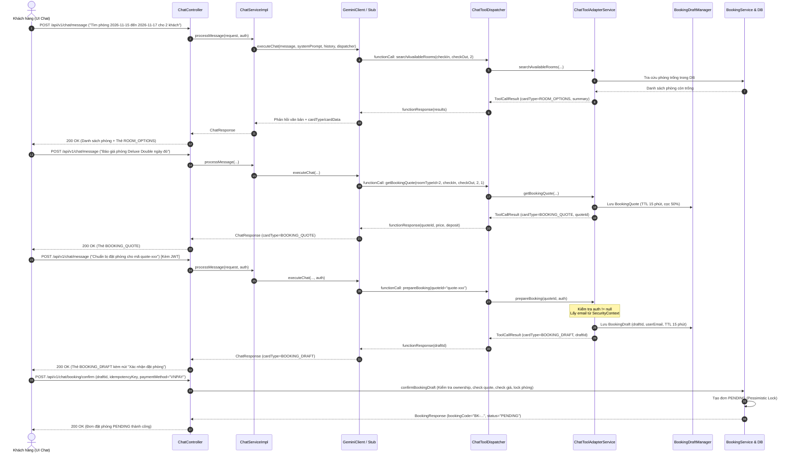

# Tài Liệu Kỹ Thuật: Chatbot AI Function Calling & Hỗ Trợ Đặt Phòng
**Mã Task**: `[SP2-CHAT-TOOLS-01]`  
**Phụ trách**: Phan Thuận Thành — Backend  
**Phiên bản**: 2.0 (Spring Boot 3.3.5 / Java 21 LTS / Google Gemini 1.5/2.0 Function Calling / Provider Stub)  
**Tài liệu liên quan**: [SRS.md](../SRS.md), [docs/api/chat.md](./chat.md)

---

## 1. Tổng Quan Kiến Trúc & Luồng Nghiệp Vụ

Chatbot của Grand Aurora Luxury Hotel được tích hợp cơ chế **Gemini Function Calling (Tools)** kết hợp bảo mật đa lớp:
1. **Model đề xuất gọi Tool**: Dựa trên câu hỏi của khách hàng, Google Gemini (hoặc Provider Stub khi kiểm thử/ngoại tuyến) phân tích ý định và trả về lệnh gọi hàm (`functionCall`).
2. **Backend kiểm soát & thực thi (Dispatcher & Adapter)**:
   - Kiểm tra **Allowlist**: Chỉ cho phép 4 tool an toàn. Tuyệt đối chặn đứng các yêu cầu vượt quyền (sửa giá, hủy đơn, thanh toán, can thiệp SQL).
   - Xác thực & chuyển đổi tham số (ngày quá khứ, số lượng khách, định dạng).
   - Tái sử dụng tầng nghiệp vụ hiện hữu (`RoomService`, `BookingDraftManager`, `RoomTypeRepository`) để truy vấn dữ liệu thật từ cơ sở dữ liệu.
   - Trả dữ liệu thật cho Model để sinh câu trả lời tự nhiên kèm cấu trúc thẻ giao diện (`cardType`, `cardData`).
3. **Khách hàng tự xác nhận tạo đơn đặt phòng**:
   - AI **không có quyền** tự tạo booking, tự thanh toán hay tự xác nhận thành công.
   - Khách hàng xem lại thông tin trên thẻ giao diện (`BOOKING_DRAFT`) và tự bấm nút **"Xác nhận đặt phòng"**.
   - Frontend gửi yêu cầu tới endpoint bảo mật `POST /api/v1/chat/booking/confirm` kèm `draftId` và `idempotencyKey`.
   - Backend sử dụng cơ chế khóa **Pessimistic Lock** qua `BookingService` để chống overbooking và trả về mã booking ở trạng thái **PENDING**.

---

## 2. Sequence Diagram (Quy Trình Từ Tra Cứu Đến Tạo Booking)



---

## 3. Danh Sách 4 Tool Của AI (Gemini Function Declarations)

### Tool 1: `searchAvailableRooms`
- **Mục đích**: Tra cứu danh sách loại phòng và số lượng phòng còn trống theo khoảng ngày nhận/trả phòng và số khách từ cơ sở dữ liệu thật.
- **Tham số đầu vào**:
  | Tên tham số | Kiểu dữ liệu | Bắt buộc | Mô tả |
  | :--- | :--- | :--- | :--- |
  | `checkIn` | `String` | **Có** | Ngày nhận phòng định dạng `YYYY-MM-DD` (không được ở quá khứ). |
  | `checkOut` | `String` | **Có** | Ngày trả phòng định dạng `YYYY-MM-DD` (phải sau ngày nhận phòng). |
  | `guests` | `Integer` | Không | Số lượng khách lưu trú (mặc định: `2`). |
  | `roomTypeId`| `Long` | Không | Mã ID loại phòng nếu khách yêu cầu cụ thể. |
- **Ràng buộc & Guardrails**:
  - Thiếu ngày hoặc số khách: AI phải hỏi lại lịch sự, tuyệt đối không được tự bịa số liệu.
  - Ngày trong quá khứ hoặc `checkOut <= checkIn`: Trả thông báo lỗi hướng dẫn khách chọn lại.
- **Card Type trả về**: `ROOM_OPTIONS`

### Tool 2: `getRoomTypeDetails`
- **Mục đích**: Lấy thông tin chi tiết, mô tả, danh sách tiện nghi và sức chứa công khai của một loại phòng.
- **Tham số đầu vào**:
  | Tên tham số | Kiểu dữ liệu | Bắt buộc | Mô tả |
  | :--- | :--- | :--- | :--- |
  | `roomTypeId` | `Long` | **Có** | Mã loại phòng (1: Standard Single, 2: Deluxe Double, 3: Executive Suite). |
- **Ràng buộc**: Tuyệt đối không trả thông tin riêng tư, dữ liệu khách hay quản trị.
- **Card Type trả về**: `ROOM_OPTIONS`

### Tool 3: `getBookingQuote`
- **Mục đích**: Tính báo giá đặt phòng gồm số đêm, đơn giá niêm yết, tổng tiền và số tiền cọc 50% theo quy định khách sạn.
- **Tham số đầu vào**:
  | Tên tham số | Kiểu dữ liệu | Bắt buộc | Mô tả |
  | :--- | :--- | :--- | :--- |
  | `roomTypeId` | `Long` | **Có** | Mã ID loại phòng muốn đặt. |
  | `checkIn` | `String` | **Có** | Ngày nhận phòng (`YYYY-MM-DD`). |
  | `checkOut` | `String` | **Có** | Ngày trả phòng (`YYYY-MM-DD`). |
  | `guests` | `Integer` | Không | Số lượng khách (mặc định theo sức chứa phòng). |
  | `quantity` | `Integer` | Không | Số lượng phòng muốn đặt (mặc định: `1`). |
- **Ràng buộc**:
  - Số khách không được vượt quá tổng sức chứa của số phòng yêu cầu.
  - Kiểm tra phòng trống thời gian thực: nếu hết phòng thì từ chối báo giá.
  - Cấp `quoteId` có thời hạn hiệu lực **15 phút**.
  - **Lưu ý nghiệp vụ**: Báo giá không có tác dụng giữ phòng trước.
- **Card Type trả về**: `BOOKING_QUOTE`

### Tool 4: `prepareBooking`
- **Mục đích**: Chuẩn bị bản nháp đặt phòng dựa trên `quoteId` còn hiệu lực.
- **Tham số đầu vào**:
  | Tên tham số | Kiểu dữ liệu | Bắt buộc | Mô tả |
  | :--- | :--- | :--- | :--- |
  | `quoteId` | `String` | **Có** | Mã báo giá hợp lệ còn thời hạn hiệu lực. |
  | `specialRequests` | `String` | Không | Yêu cầu đặc biệt của khách (ví dụ: tầng cao, view biển). |
- **Ràng buộc bảo mật tối thượng**:
  - **Yêu cầu đăng nhập**: Nếu khách chưa đăng nhập (`Authentication == null` hoặc `anonymousUser`), trả về thẻ `LOGIN_REQUIRED`. Tuyệt đối không tạo bản nháp.
  - **Không nhận `customerId` từ model**: Email khách hàng được trích xuất an toàn 100% từ Spring `SecurityContextHolder`. Model không thể mạo danh tài khoản khác.
  - **Chưa tạo booking, chưa giữ phòng**: Chỉ sinh bản nháp `BookingDraft` (thời hạn 15 phút) để render thẻ xác nhận cho khách hàng bấm.
- **Card Type trả về**: `BOOKING_DRAFT` (hoặc `LOGIN_REQUIRED` nếu chưa đăng nhập).

---

## 4. Danh Sách Tool Bị Cấm Tuyệt Đối (Security Guardrails)

Hệ thống cấu hình cơ chế từ chối tự động (Deny-by-default) thông qua `ChatToolDispatcher`. Model và khách hàng tuyệt đối **KHÔNG** thể gọi các hành động sau:
- `confirmBooking`, `createBooking`: Chỉ khách hàng bấm nút trên UI mới được gọi endpoint xác nhận.
- `processPayment`, `payBooking`: Mọi thanh toán phải qua cổng VNPay chính thức.
- `refundDeposit`, `cancelBooking`: Phải qua quy trình hủy phòng chuẩn của khách sạn.
- `executeSql`, `updateDatabase`, `dropTable`: Chống tấn công tiêm mã và khai thác dữ liệu.
- `updatePrice`: Giá phòng cố định theo chính sách ban điều hành khách sạn.

---

## 5. Contract API Endpoint Xác Nhận Đặt Phòng

### Endpoint: `POST /api/v1/chat/booking/confirm`
- **Mô tả**: Endpoint dành cho người dùng cuối bấm nút "Xác nhận đặt phòng" trên thẻ giao diện Chat.
- **Yêu cầu xác thực**: Bắt buộc đăng nhập (`Authorization: Bearer <JWT_TOKEN>`).

#### Request Payload:
```json
{
  "draftId": "draft-8f3e2b1c-9a4d-4b8f-8e2a-1b2c3d4e5f6a",
  "idempotencyKey": "idem-99283-abc-1106",
  "paymentMethod": "VNPAY",
  "note": "Xin hỗ trợ nhận phòng sớm nếu có thể"
}
```

#### Field Specifications:
| Trường | Kiểu | Bắt buộc | Ràng buộc |
| :--- | :--- | :--- | :--- |
| `draftId` | `String` | **Có** | Không để trống. Mã bản nháp sinh ra từ `prepareBooking`. |
| `idempotencyKey` | `String` | **Có** | Không để trống. Khóa chống trùng lặp request khi retry hoặc bấm nút nhiều lần. |
| `paymentMethod` | `String` | **Có** | Phương thức thanh toán (mặc định: `"VNPAY"`). |
| `note` | `String` | Không | Ghi chú thêm từ khách hàng. |

#### Response Thành Công (HTTP 200 OK):
```json
{
  "success": true,
  "message": "Xác nhận tạo đơn đặt phòng thành công",
  "data": {
    "bookingId": 142,
    "bookingCode": "BK-20261106-00142",
    "roomTypeName": "Deluxe Double Room",
    "quantity": 1,
    "guests": 2,
    "checkIn": "2026-11-15",
    "checkOut": "2026-11-17",
    "nights": 2,
    "totalPrice": 1900000,
    "depositAmount": 950000,
    "paymentMethod": "VNPAY",
    "bookingStatus": "PENDING",
    "createdAt": "2026-11-06T12:00:00"
  }
}
```

#### Các Mã Lỗi Thường Gặp:
| Mã HTTP | Tình huống | Ý nghĩa |
| :--- | :--- | :--- |
| **401 Unauthorized** | Chưa đăng nhập hoặc Token JWT hết hạn | Bắt buộc đăng nhập tài khoản trước khi đặt phòng. |
| **403 Forbidden** | `draftId` thuộc tài khoản khách hàng khác | Chống mạo danh hoặc chiếm dụng draft của người khác. |
| **400 Bad Request** | Bản nháp không tồn tại hoặc đã quá hạn 15 phút | Yêu cầu khách hàng lấy báo giá và chuẩn bị bản nháp mới. |
| **409 Conflict** | Giá phòng trong DB bị thay đổi so với giá báo | Giá phòng đã được cập nhật, yêu cầu khách lấy báo giá mới. |
| **400 / 409** | Hết phòng trống (Overbooking check) | Bị chặn bởi cơ chế Pessimistic Write Lock của `BookingService`. |

---

## 6. Contract Thẻ Giao Diện Chat (Frontend Integration)

Đối với mỗi phản hồi từ `POST /api/v1/chat/message`, trường `cardType` và `cardData` cho phép UI render thẻ tương tác trực quan:

### 1. Thẻ `ROOM_OPTIONS`
```json
{
  "cardType": "ROOM_OPTIONS",
  "cardData": [
    {
      "roomTypeId": 2,
      "name": "Deluxe Double Room",
      "description": "Ban công riêng ngắm trọn biển Mỹ Khê",
      "capacity": 2,
      "basePrice": 950000,
      "availableRooms": 5,
      "amenities": ["Wifi tốc độ cao", "Smart TV 55 inch", "Ban công biển"],
      "primaryImageUrl": "https://grandaurora.com/images/deluxe-double.jpg"
    }
  ]
}
```

### 2. Thẻ `BOOKING_QUOTE`
```json
{
  "cardType": "BOOKING_QUOTE",
  "cardData": {
    "quoteId": "quote-8a9b1c2d",
    "roomTypeId": 2,
    "roomTypeName": "Deluxe Double Room",
    "checkIn": "2026-11-15",
    "checkOut": "2026-11-17",
    "nights": 2,
    "guests": 2,
    "quantity": 1,
    "pricePerNight": 950000,
    "totalPrice": 1900000,
    "depositAmount": 950000,
    "expiresAt": "2026-11-06T12:15:00",
    "note": "Báo giá có hiệu lực trong 15 phút và không giữ phòng trước."
  }
}
```

### 3. Thẻ `BOOKING_DRAFT` (Có Nút "Xác nhận đặt phòng")
```json
{
  "cardType": "BOOKING_DRAFT",
  "cardData": {
    "draftId": "draft-b2c3d4e5",
    "quoteId": "quote-8a9b1c2d",
    "roomTypeId": 2,
    "roomTypeName": "Deluxe Double Room",
    "checkIn": "2026-11-15",
    "checkOut": "2026-11-17",
    "nights": 2,
    "quantity": 1,
    "guests": 2,
    "totalPrice": 1900000,
    "depositAmount": 950000,
    "specialRequests": "Phòng tầng cao không hút thuốc",
    "userEmail": "customer@gmail.com",
    "expiresAt": "2026-11-06T12:15:00",
    "status": "DRAFT"
  }
}
```
*Giao diện Frontend khi nhận thẻ `BOOKING_DRAFT` sẽ hiển thị nút bấm gọi `POST /api/v1/chat/booking/confirm` với `draftId` và sinh ngẫu nhiên một `idempotencyKey`.*

### 4. Thẻ `LOGIN_REQUIRED`
```json
{
  "cardType": "LOGIN_REQUIRED",
  "cardData": {
    "message": "Vui lòng đăng nhập để tiếp tục đặt phòng",
    "quoteId": "quote-8a9b1c2d"
  }
}
```
*Giao diện Frontend hiển thị nút mở Modal Đăng nhập / Chuyển hướng tới trang Login.*

