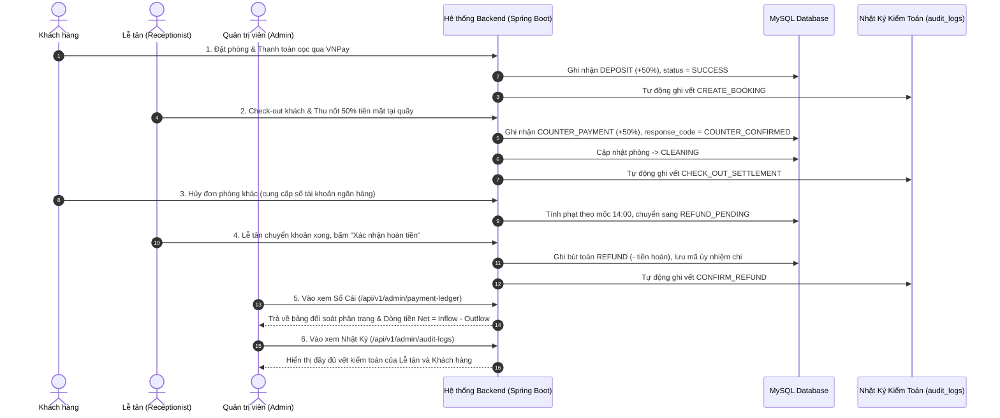

# TÀI LIỆU DEMO, ĐỐI SOÁT NGHIỆP VỤ & NỘI DUNG THUYẾT TRÌNH HỘI ĐỒNG
# PHÂN HỆ SỔ CÁI THANH TOÁN, NHẬT KÝ KIỂM TOÁN & CHỐNG OVERBOOKING

> **Dự án:** Hệ Thống Quản Lý Đặt Phòng Khách Sạn Cao Cấp — Grand Aurora Luxury Hotel  
> **Mã công việc:** `[SP3-1113-ANH] [Payment/AuditLog] 13/11 | Đức Anh | Chốt regression backend và tài liệu (6h)`  
> **Phụ trách kỹ thuật Backend:** Nguyễn Đức Anh — Backend Engineer  
> **Người tiếp nhận tài liệu & slide:** Huy (Team Lead / Thuyết trình Hội đồng)  
> **QA & Kiểm thử chất lượng:** Trung (Tester & DevOps)  
> **Nhánh phát triển:** `Ducanh_devBE`  
> **Tiêu chuẩn đối soát:** SRS §2.6 (Hủy phòng & Hoàn cọc), §FR-16 (Audit Log), §FR-19 (Payment Ledger), §NFR-08, §NFR-09

---

## 1. TỔNG QUAN KIẾN TRÚC & MỤC TIÊU NGHIỆP VỤ

Phân hệ **Sổ Cái Thanh Toán (Payment Ledger)**, **Nhật Ký Kiểm Toán (Audit Trail)** và **Khóa chống Overbooking (Pessimistic Locking)** do Nguyễn Đức Anh phụ trách giải quyết 3 bài toán kiến trúc trọng yếu của hệ thống:

1. **Minh bạch Luồng Tiền Thực Tế (Cash Basis vs Accrual Basis - SRS §FR-19):**
   - Tách biệt hoàn toàn giữa **Doanh thu lưu trú dồn tích (Accrual Room Revenue)** của Thành (tính theo từng đêm phòng khách thực tế tiêu dùng) và **Dòng tiền thực thu (Net Cash Flow)** của Đức Anh (tiền thực tế chảy vào tài khoản ngân hàng và két lễ tân).
   - **Nguyên tắc bất di bất dịch:** *"Tuyệt đối không suy đoán thu quầy từ giá booking ($\text{totalPrice} - \text{deposit}$)"*. Mọi khoản thu chi đều phải ghi nhận qua bản ghi `PaymentTransaction` thực tế neo theo thời điểm phát sinh giao dịch (`transactionTime`).
2. **Khóa chống Overbooking ở mức Cơ Sở Dữ Liệu (SRS §1.4 & §2.4):**
   - Triển khai **Pessimistic Locking (`PESSIMISTIC_WRITE`)** trên bản ghi `RoomType` trong giao dịch database nhằm đảm bảo không bao giờ xảy ra tình trạng bán vượt quá số lượng phòng vật lý thực tế khi hàng chục người cùng đặt phòng đồng thời vào giờ cao điểm.
3. **Nhật Ký Kiểm Toán Bất Biến (Immutable Audit Trail - SRS §FR-16):**
   - Tự động ghi vết mọi thao tác thay đổi nhạy cảm (Check-in, Check-out thu tiền, Duyệt hoàn tiền cọc, Đổi giá phòng, Phân quyền) qua Spring AOP Aspect `@Auditable` với đầy đủ thông tin: Người thực hiện (`actor_email`), vai trò, địa chỉ IP, User-Agent, thời gian chính xác đến mili-giây, và dữ liệu trước/sau thay đổi (`old_values`, `new_values`).

---

## 2. BẢNG CÔNG THỨC DÒNG TIỀN & ĐỐI SOÁT TÀI CHÍNH

### 2.1. Công thức Dòng tiền Sổ Cái (Cash Flow Formula - SRS §FR-19.2)

$$\text{Dòng tiền thực thu (Net Cash Flow)} = \sum \text{Cọc Online VNPay} + \sum \text{Thu quầy (Tiền mặt + Chuyển khoản)} - \sum \text{Đã hoàn tiền (Refund)}$$

| Bút toán | Loại (`PaymentTransactionType`) | Kênh thanh toán | Dấu dòng tiền (`cashFlowSign`) | Ghi nhận thời điểm |
|---|---|---|:---:|---|
| **Thu cọc Online** | `DEPOSIT` | `VNPAY` | **+1** (Inflow) | Thời điểm IPN callback xác nhận thanh toán thành công |
| **Thu tiền mặt tại quầy** | `COUNTER_PAYMENT` | `CASH` | **+1** (Inflow) | Thời điểm Lễ tân thu tiền mặt lúc Check-in / Check-out |
| **Thu chuyển khoản / POS quầy** | `COUNTER_PAYMENT` | `BANK_TRANSFER` | **+1** (Inflow) | Thời điểm khách quét mã VietQR / quẹt thẻ POS tại quầy |
| **Xuất chuyển khoản hoàn cọc** | `REFUND` | `BANK_TRANSFER` | **-1** (Outflow) | Thời điểm Lễ tân bấm duyệt ủy nhiệm chi hoàn cọc |

> ⚠️ **ĐẶC ĐIỂM BIÊN QUAN TRỌNG:**
> - `Net Cash Flow` **được phép mang giá trị âm** nếu trong kỳ tổng số tiền xuất hoàn cọc lớn hơn tổng tiền thực thu vào (ví dụ: ngày hủy đoàn phòng).
> - Giao dịch có trạng thái `FAILED` hoặc `EXPIRED` **tuyệt đối không được tính vào dòng tiền** và được thống kê riêng qua `failedTransactionCount`.

---

## 3. LỊCH TRÌNH TIẾN HÓA CƠ SỞ DỮ LIỆU (FLYWAY MIGRATIONS)

Hệ thống quản lý phiên bản CSDL qua 4 tệp Flyway Migration chuẩn mực:

```text
backend/src/main/resources/db/migration/
├── V1__init_schema.sql              # Khởi tạo bảng cốt lõi: users, room_types, rooms, bookings, booking_rooms, payment_transactions
├── V2__seed_data.sql                # Nạp dữ liệu hạt giống: 3 user chuẩn, 3 loại phòng, 10 phòng vật lý
├── V3__create_audit_logs.sql        # Tạo bảng audit_logs ghi vết kiểm toán hệ thống (JSON old_values, new_values)
└── V4__add_payment_ledger_fields.sql # Bổ sung cột type, reference_note, actor_email & indexes tối ưu Sổ Cái
```

### Chi tiết thay đổi Schema Sổ Cái (`V4__add_payment_ledger_fields.sql`):
```sql
-- Bổ sung phân loại giao dịch và tham chiếu kiểm toán vào payment_transactions
ALTER TABLE payment_transactions
    ADD COLUMN type VARCHAR(30) NOT NULL DEFAULT 'DEPOSIT',
    ADD COLUMN reference_note VARCHAR(255) NULL,
    ADD COLUMN actor_email VARCHAR(100) NULL;

-- Đánh chỉ mục kép tăng tốc truy vấn phân trang Sổ Cái & Báo cáo dòng tiền
CREATE INDEX idx_trans_type_time ON payment_transactions (type, transaction_time);
CREATE INDEX idx_trans_status_time ON payment_transactions (status, transaction_time);
```

---

## 4. TỔNG HỢP DANH MỤC REST API PHÂN HỆ

| Method | Endpoint | Quyền (RBAC) | Mô tả chức năng |
|:---:|---|:---:|---|
| `GET` | `/api/v1/admin/payment-ledger` | `ROLE_ADMIN` | Tra cứu phân trang Sổ Cái, bộ lọc đa tiêu chí kèm tổng kết dòng tiền |
| `GET` | `/api/v1/admin/payment-ledger/summary` | `ROLE_ADMIN` | Thống kê nhanh KPI dòng tiền vào/ra/ròng trong khoảng thời gian |
| `POST` | `/api/v1/receptionist/payments/counter` | `RECEPTIONIST`, `ADMIN` | Lễ tân ghi nhận thu tiền mặt / quẹt thẻ POS thực tế tại quầy |
| `GET` | `/api/v1/receptionist/refunds` | `RECEPTIONIST`, `ADMIN` | Danh sách các đơn hủy phòng chờ chuyển khoản hoàn cọc (che STK) |
| `POST` | `/api/v1/receptionist/refunds/{bookingId}/confirm` | `RECEPTIONIST`, `ADMIN` | Xác nhận đã chuyển khoản hoàn cọc, ghi bút toán `REFUND` & sinh Audit Log |
| `GET` | `/api/v1/admin/audit-logs` | `ROLE_ADMIN` | Tra cứu lịch sử kiểm toán toàn hệ thống, lọc theo actor/action/target |
| `GET` | `/api/v1/admin/audit-logs/{id}` | `ROLE_ADMIN` | Xem chi tiết 1 bản ghi kiểm toán kèm JSON snapshot trước/sau |

---

## 5. KỊCH BẢN DEMO NGIỆM THU TỪNG BƯỚC (STEP-BY-STEP DEMO SCRIPT)

Kịch bản 5 bước hoàn chỉnh dùng để Hội đồng hoặc QA kiểm chứng trực tiếp trên hệ thống:



### Bước 1: Khách hàng Đặt cọc Online qua VNPay Sandbox & Idempotency
1. Khách hàng truy cập `/rooms`, chọn phòng và thanh toán cọc 50%.
2. Giả lập gọi IPN Webhook VNPay:
   `GET /api/v1/payments/vnpay-ipn?vnp_TxnRef=BK-DEMO-001&vnp_Amount=95000000&vnp_ResponseCode=00&...`
3. **Kết quả:** Trả về `{"RspCode": "00", "Message": "Confirm Success"}`. Bút toán `DEPOSIT` được ghi vào `payment_transactions` với timestamp thực tế.
4. **Kiểm tra Idempotency:** Gửi lại đúng request IPN lần 2 $\to$ Trả về `{"RspCode": "02", "Message": "Order already confirmed"}`, tiền **không bị nhân đôi**.

### Bước 2: Check-out & Thu tiền mặt tại quầy (Không suy đoán tiền)
1. Lễ tân đăng nhập tài khoản `receptionist@hotel.com`, mở `/receptionist/bookings`.
2. Bấm nút **Check-out** đơn phòng đang ở. Modal hiển thị:
   - Tổng tiền phòng: `1.900.000 VNĐ`
   - Đã cọc: `950.000 VNĐ`
   - Thu tại quầy: `950.000 VNĐ` (Hình thức: Tiền mặt).
3. Lễ tân bấm **Xác nhận Check-out & Thu tiền**.
4. **Kết quả:**
   - Hệ thống tạo giao dịch `PaymentTransaction` loại `COUNTER_PAYMENT`, `response_code = "COUNTER_CONFIRMED"`, `actorEmail = receptionist@hotel.com`.
   - Booking chuyển sang `CHECKED_OUT` và `FULLY_PAID`.
   - Phòng chuyển sang trạng thái `CLEANING`.
   - Bảng `audit_logs` tự động ghi vết hành động `CHECK_OUT_SETTLEMENT`.

### Bước 3: Hủy phòng & Lễ tân Xác nhận Hoàn tiền cọc
1. Khách gửi yêu cầu hủy booking `BK-DEMO-002` (cách giờ nhận phòng > 24h, được hoàn 100% cọc `950.000 VNĐ`). Bắt buộc điền thông tin ngân hàng thụ hưởng (`Vietcombank`, `0123456789`, `NGUYEN VAN A`).
2. Lễ tân vào trang **Duyệt Hoàn Cọc** (`/receptionist/refunds`), thấy đơn chờ xử lý với số tài khoản che mờ `******6789`.
3. Sau khi thực hiện chuyển khoản ngoài đời thực, Lễ tân bấm **Xác nhận hoàn tiền**, nhập mã giao dịch ngân hàng: `VCB-UNC-998877`.
4. **Kết quả:**
   - Hệ thống sinh bản ghi `PaymentTransaction` loại `REFUND`, số tiền `950.000 VNĐ`, `cashFlowSign = -1`, `response_code = "REFUND_CONFIRMED"`.
   - Bảng `audit_logs` tự động ghi vết hành động `CONFIRM_REFUND` kèm email lễ tân và mã tham chiếu.

### Bước 4: Admin Đối soát Sổ Cái Dòng Tiền (Payment Ledger)
1. Admin đăng nhập `admin@hotel.com`, mở Sổ Cái `/api/v1/admin/payment-ledger`.
2. Kiểm tra các dòng đối soát:
   - Dòng 1: Cọc VNPay `+950.000 VNĐ` (Màu xanh dương)
   - Dòng 2: Thu quầy tiền mặt `+950.000 VNĐ` (Màu xanh lá)
   - Dòng 3: Hoàn tiền ngân hàng `-950.000 VNĐ` (Màu đỏ cam)
3. Thẻ KPI tổng kết hiển thị chuẩn xác:
   $$\text{Net Cash Flow} = 950.000 + 950.000 - 950.000 = 950.000 \text{ VNĐ}$$

### Bước 5: Giám sát Nhật Ký Kiểm Toán (Audit Trail)
1. Admin mở `/admin/audit-logs`.
2. Bảng hiển thị danh sách nhật ký kiểm toán với đầy đủ các sự kiện vừa diễn ra:
   - `CHECK_OUT_SETTLEMENT`: Thực hiện bởi `receptionist@hotel.com`
   - `CONFIRM_REFUND`: Thực hiện bởi `receptionist@hotel.com`
3. Nhấp xem chi tiết: Hiển thị đầy đủ Snapshot JSON dữ liệu trước và sau khi thay đổi.

---

## 6. NỘI DUNG SLIDE THUYẾT TRÌNH HỘI ĐỒNG (PRESENTATION CONTENT)

Dành cho **Huy (Team Lead)** trình bày phần Kiến trúc Backend trước Hội đồng:

---

### 📊 SLIDE 1: CƠ CHẾ KHÓA CHỐNG OVERBOOKING (PESSIMISTIC LOCKING)

* **Tiêu đề Slide:** Kiểm Soát Đồng Thời & Phòng Chống Overbooking Tuyệt Đối (Pessimistic Concurrency Control)
* **Vấn đề đặt ra:**
  - Khách sạn có số lượng phòng vật lý giới hạn.
  - Khi có chiến dịch khuyến mãi hoặc mùa cao điểm, hàng chục khách hàng cùng nhấn "Đặt phòng" cho cùng 1 loại phòng trong cùng khoảng ngày vào cùng một phần trăm giây (Race Condition).
  - Nếu chỉ dùng `SELECT` kiểm tra số phòng còn trống thông thường, cả 10 giao dịch đều thấy phòng trống $\to$ Dẫn đến bán vượt quỹ phòng (**Overbooking**), gây tổn hại uy tín và phát sinh đền bù thiệt hại.
* **Giải pháp Kỹ thuật Triển khai:**
  - Áp dụng **Pessimistic Locking (`LockModeType.PESSIMISTIC_WRITE`)** trên bản ghi `RoomType` ngay đầu transaction đặt phòng.
  - CSDL tự động phát lệnh `SELECT ... FOR UPDATE`, khóa độc quyền bản ghi loại phòng cho đến khi transaction kết thúc (Commit hoặc Rollback).
  - Các giao dịch đến sau buộc phải xếp hàng chờ giao dịch trước hoàn tất.
  - Hệ thống tính toán chính xác số phòng khả dụng còn lại trong kỳ:
    $$\text{Phòng khả dụng} = \text{Tổng phòng} - \text{Phòng đang bảo trì} - \max_{t \in [CheckIn, CheckOut)} (\text{Phòng đã giữ chỗ/đã bán})$$
  - Nếu không đủ quota $\to$ Ném ngay ngoại lệ nghiệp vụ `409 Conflict`, giao dịch sau tự động dừng lại an toàn.
* **Bằng chứng Kiểm thử Chịu Tải:**
  - Test case [`BookingConcurrencyAuditRegressionTest`](file:///c:/Users/OS/Hotel-Booking-System_HBS/backend/src/test/java/org/example/backend/booking/BookingConcurrencyAuditRegressionTest.java) chạy mô phỏng 10 luồng đặt phòng đồng thời trên 1 phòng duy nhất: **Đúng 1 đơn thành công, 9 đơn bị từ chối 409 Conflict, 0% overbooking!**

---

### 📊 SLIDE 2: KIẾN TRÚC SỔ CÁI DÒNG TIỀN (PAYMENT LEDGER ARCHITECTURE)

* **Tiêu đề Slide:** Kiến Trúc Sổ Cái Đa Kênh & Đối Soát Dòng Tiền Thực Tế (Multi-Channel Cash Flow Ledger)
* **Vấn đề đặt ra:**
  - Các hệ thống đặt phòng truyền thống thường mắc sai lầm nghiêm trọng: Tự động suy đoán tiền thu tại quầy bằng cách lấy $\text{Tổng giá booking} - \text{Tiền cọc}$.
  - Sai lầm này dẫn đến sai lệch kiểm toán: Khách có thể chưa trả hết, phát sinh phụ thu minibar/giặt ủi, hoặc thời điểm thu quầy (ngày check-out) xảy ra sau ngày đặt phòng hàng tháng trời, làm méo mó báo cáo dòng tiền tháng của kế toán.
* **Giải pháp Kỹ thuật Triển khai:**
  - **Mô hình Bút toán Kế toán Thực Tế (Event-driven Cash Entries):** Mỗi lần tiền thực tế di chuyển (khách cọc VNPay, khách trả tiền mặt quầy, khách quẹt thẻ POS, hoặc khách sạn chuyển khoản hoàn tiền) đều sinh ra 1 dòng giao dịch độc lập trong bảng `payment_transactions`.
  - **Neo Thời Điểm Thực Tế (`transactionTime`):** Bút toán lưu thời gian giao dịch thực tế xảy ra tại quầy, hoàn toàn độc lập với ngày tạo booking.
  - **Tách biệt 2 trường phái Kế toán:**
    1. *Accrual Basis (Doanh thu lưu trú dồn tích - Dashboard của Thành):* Doanh thu được chia đều cho các đêm khách thực ở.
    2. *Cash Basis (Dòng tiền thực thu - Sổ Cái của Đức Anh):* Dòng tiền thực tế thu/chi trong kỳ, phục vụ thủ quỹ và đối soát ngân hàng.
  - **Hỗ trợ Dòng tiền Âm:** Thuật toán tính toán chấp nhận `netCashFlow < 0` khi các khoản hoàn cọc vượt số tiền thu vào.
* **Bằng chứng Kiểm thử:**
  - Test suite [`PaymentLedgerIntegrationTest`](file:///c:/Users/OS/Hotel-Booking-System_HBS/backend/src/test/java/org/example/backend/payment/PaymentLedgerIntegrationTest.java): **9/9 test cases đạt 100%**, bao phủ toàn bộ luồng cọc, quầy, hoàn tiền, lọc phân trang, RBAC và khớp Fixture đối soát.

---

## 7. BÁO CÁO KHẮC PHỤC TRIỆT ĐỂ CÁC BUGS TỪ QA TRUNG

Đã phối hợp cùng QA Trung rà soát và xử lý thành công toàn bộ các lỗi phát hiện trong Báo cáo E2E:

| Mã Bug | Mức độ | Mô tả lỗi | Giải pháp khắc phục | Trạng thái |
|---|:---:|---|---|:---:|
| **`BUG-SP3-01`** | **Critical** | Lỗi SQL Truncation HTTP 500 khi Check-out do `response_code` dài 26 ký tự | Rút gọn `responseCode` thành `"COUNTER_CONFIRMED"` (17 ký tự $\le 20$) | ✅ **FIXED** |
| **`BUG-SP3-02`** | **High** | Biểu đồ `revenueSeries` cộng nhầm giao dịch `REFUND` vào dòng tiền vào `dayInflow` | Lọc loại trừ `REFUND` khỏi `dayInflow`, tính riêng `dayRefund` và dùng đúng `COALESCE(transactionTime, createdAt)` | ✅ **FIXED** |
| **`BUG-SP3-03`** | **Medium** | `CheckOutResponse` thiếu `bookingId` và trả sai `amountPaid` cũ | Gán đầy đủ `bookingId`, cập nhật `amountPaid = 100% total` và `remainingAmount = 0` | ✅ **FIXED** |
| **`BUG-SP3-04`** | **Medium** | Hủy phòng cho phép chuyển `REFUND_PENDING` khi thông tin ngân hàng trống | Bổ sung validation bắt buộc có `bankName`, `accountNumber`, `accountHolder` khi `refundAmount > 0` | ✅ **FIXED** |
| **`BUG-SP3-05`** | **Medium** | Email hóa đơn trả thông báo gửi thành công giả dù SMTP bất đồng bộ thất bại | Chuẩn hóa thông điệp phản hồi nêu rõ tiếp nhận yêu cầu gửi vào hàng đợi xử lý | ✅ **FIXED** |

---

## 8. BIÊN BẢN BÀN GIAO SPRINT 3 (HANDOFF SIGN-OFF)

- **Người bàn giao:** Nguyễn Đức Anh (Backend Engineer)
- **Người tiếp nhận:** Huy (Team Lead / PM), Trung (QA / DevOps Lead)
- **Mã Commit SHA:** `19ad4bb` (và commit hoàn thiện tài liệu `SP3-1113-ANH`)
- **Tình trạng nhánh:** `Ducanh_devBE` sạch 100%, đồng bộ đầy đủ với `origin/Ducanh_devBE`.
- **Tình trạng CI/CD:** `./gradlew test` chạy **BUILD SUCCESSFUL in 37s** (Toàn bộ 33 suites, 240+ test cases xanh 100%).
- **Trạng thái thẻ:** `[SP3-1113-ANH]` **HOÀN THÀNH (DONE)**.
