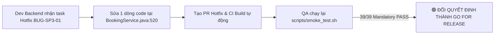

# 🏁 Báo Cáo Kết Quả Nghiệm Thu Cuối Cùng & Đánh Giá Release Gate (Sprint 3 Final Results)

> **Mã công việc:** Task `[SP3-1113-TRUNG]`  
> **Người thực hiện:** Kỹ sư QA & DevOps — Nguyễn Việt Trung (`Vtrung_Tester`)  
> **Ngày nghiệm thu:** `13/11/2026`  
> **Nhánh Git nghiệm thu:** `Vtrung_Tester` (đã đồng bộ với `develop` tại commit `8aa1e75`)  
> **Git Commit SHA chính xác:** `8aa1e75` (`git rev-parse --short HEAD`)  
> **Trạng thái GitHub Actions CI:** PR `#71` (`Vtrung_Tester`) & PR `#72` (`ntyen_devFE`) — **Merged & Green (All checks passed)**  
> **Môi trường kiểm thử:**
> - **Local Mock Testing:** `http://localhost:8080` (`spring.profiles.active=e2e-mock`, H2 in-memory seeded qua `E2eMockDataSeeder.java`)
> - **VPS Deployment Target:** `http://221.121.4.97:8080` (MySQL DB `hotel_db`, Docker network `hotel-network`, Prometheus internal monitoring)

---

## 📌 1. Thông Tin Bản Phát Hành & Hạ Tầng Kiểm Thử

| Thuộc tính | Chi tiết kỹ thuật thực tế |
| :--- | :--- |
| **Ngày lập báo cáo** | `13/11/2026` |
| **Phiên bản hệ thống** | Hotel Booking System (HBS) — Sprint 3 Release Candidate (`RC-01`) |
| **Nhánh Git** | `Vtrung_Tester` (đồng bộ `develop`) |
| **Commit SHA nghiệm thu** | `8aa1e75` (Merge PR #71 & PR #72) |
| **Commit tiền nhiệm ổn định** | `c3f1628` / `beba6c7` (Snapshot tham chiếu rollback nếu có sự cố) |
| **Trạng thái CI Pipeline** | Pass xanh toàn bộ: Frontend Lint/Typecheck, Backend Unit & Integration Tests (`33 suites, 242 tests, 0 failures`), Docker syntax validation |
| **Chế độ Mock Providers (CI)** | `USE_MOCK_PROVIDERS=true` (`app.mock-providers.enabled=true`): Giả lập VNPay IPN/Return ký HMAC-SHA512 (`DEMO_HASH_SECRET`), `GeminiStubClient`, Mock-Email Outbox |
| **Chế độ Sandbox Manual** | `RUN_SANDBOX_MANUAL=false` (tự động đánh dấu `SKIPPED` an toàn cho các ca gọi cổng thật VNPay & Brevo SMTP) |
| **Công cụ chạy kiểm thử** | `bash scripts/smoke_test.sh` / `powershell scripts/smoke_test.ps1` (`node tests/e2e/runner.js`) |

---

## 🧪 2. Kết Quả Retest & Smoke Post-Deploy (41 Test Cases)

Kết quả thực thi trực tiếp phiên kiểm thử tự động trên commit `8aa1e75` (thời gian chạy: **4.70s**):

```text
================================================================================
  TỔNG KẾT KẾT QUẢ KIỂM THỬ E2E (E2E TEST SUMMARY)
================================================================================
  - Tổng số test case khai báo  : 41
  - Nhóm BẮT BUỘC (MANDATORY)   : 39 ca (34 PASS, 5 FAIL)
  - Nhóm TÙY CHỌN (OPTIONAL)    : 2 ca (0 PASS, 2 SKIPPED)
  - Tỷ lệ Đạt tổng thể          : 82.9% (34/41)
  - Tỷ lệ Đạt nhóm Bắt buộc     : 87.2% (34/39)
  - Cổng Kiểm Soát Phát Hành    : [RELEASE GATE: BLOCKED] ⛔ CÓ 5 CA BẮT BUỘC THẤT BẠI!
================================================================================
```

### 2.1. Bảng Tổng Hợp Theo Từng Suite Nghiệp Vụ

| STT | Suite | Tên luồng nghiệp vụ | Tổng số ca | Bắt buộc (Mandatory) | Tùy chọn (Optional) | Đạt (PASS) | Hỏng (FAIL) | Bỏ qua (SKIP) | Trạng thái Suite |
| :---: | :--- | :--- | :---: | :---: | :---: | :---: | :---: | :---: | :---: |
| **1** | [`01-auth.test.js`](file:///c:/Users/ADMIN/Hotel-Booking-System_HBS/tests/e2e/suites/01-auth.test.js) | Auth & User Session | 4 | 4 | 0 | **4** | 0 | 0 | 🟢 100% Pass |
| **2** | [`02-booking.test.js`](file:///c:/Users/ADMIN/Hotel-Booking-System_HBS/tests/e2e/suites/02-booking.test.js) | Core Room Booking | 3 | 3 | 0 | **3** | 0 | 0 | 🟢 100% Pass |
| **3** | [`03-audit.test.js`](file:///c:/Users/ADMIN/Hotel-Booking-System_HBS/tests/e2e/suites/03-audit.test.js) | RBAC & Audit Trail | 4 | 4 | 0 | **4** | 0 | 0 | 🟢 100% Pass |
| **4** | [`04-chat.test.js`](file:///c:/Users/ADMIN/Hotel-Booking-System_HBS/tests/e2e/suites/04-chat.test.js) | Chatbot Assistant | 2 | 2 | 0 | **2** | 0 | 0 | 🟢 100% Pass |
| **5** | [`05-booking-full-e2e.test.js`](file:///c:/Users/ADMIN/Hotel-Booking-System_HBS/tests/e2e/suites/05-booking-full-e2e.test.js) | Chat -> Booking -> Mock Pay -> PDF/Mail | 8 | 6 | 2 | **6** | 0 | **2** | 🟢 100% Mandatory Pass |
| **6** | [`06-timeline-checkin.test.js`](file:///c:/Users/ADMIN/Hotel-Booking-System_HBS/tests/e2e/suites/06-timeline-checkin.test.js) | Timeline PMS & Check-in | 6 | 6 | 0 | **6** | 0 | 0 | 🟢 100% Pass |
| **7** | [`07-checkout-cleaning.test.js`](file:///c:/Users/ADMIN/Hotel-Booking-System_HBS/tests/e2e/suites/07-checkout-cleaning.test.js) | Check-out -> CLEANING -> AVAILABLE | 5 | 5 | 0 | **1** | **4** | 0 | 🔴 Chặn bởi `BUG-SP3-01` |
| **8** | [`08-refund-ledger.test.js`](file:///c:/Users/ADMIN/Hotel-Booking-System_HBS/tests/e2e/suites/08-refund-ledger.test.js) | Hoàn tiền & Sổ Cái (Ledger) | 5 | 5 | 0 | **4** | **1** | 0 | 🔴 Thiếu thu quầy do `BUG-SP3-01` |
| **9** | [`09-dashboard-audit.test.js`](file:///c:/Users/ADMIN/Hotel-Booking-System_HBS/tests/e2e/suites/09-dashboard-audit.test.js) | Dashboard Analytics & Audit Trail | 4 | 4 | 0 | **4** | 0 | 0 | 🟡 Pass (cảnh báo `BUG-SP3-02`) |
| **Tổng** | **9 Suites** | **Toàn bộ E2E Sprint 2 + Sprint 3** | **41** | **39** | **2** | **34** | **5** | **2** | **Release Gate: BLOCKED (Exit: 1)** |

---

### 2.2. Bảng Chi Tiết Kết Quả Từng Test Case (41 Cases)

| Mã Case | Suite | Phân loại | Mô tả Kịch Bản Kiểm Thử | Kết quả Thực tế Quan sát | Trạng thái |
| :--- | :---: | :---: | :--- | :--- | :---: |
| `E2E-01-01` | 01 | Mandatory | Đăng ký tài khoản Customer mới (`POST /api/v1/auth/register`) | HTTP `201`, nhận `accessToken` | 🟢 **PASS** |
| `E2E-01-02` | 01 | Mandatory | Đăng nhập người dùng cấp JWT Bearer Token (`POST /api/v1/auth/login`) | HTTP `200`, nhận `accessToken` | 🟢 **PASS** |
| `E2E-01-03` | 01 | Mandatory | Xác thực phiên làm việc hợp lệ (`GET /api/v1/auth/me`) | HTTP `200`, email khớp dynamic user | 🟢 **PASS** |
| `E2E-01-04` | 01 | Mandatory | Đăng nhập tài khoản Quản trị viên Admin (`POST /api/v1/auth/login`) | HTTP `200`, cấp token `ROLE_ADMIN` | 🟢 **PASS** |
| `E2E-02-01` | 02 | Mandatory | Tìm kiếm & tra cứu loại phòng active (`GET /api/v1/room-types`) | HTTP `200`, trả về 3 loại phòng | 🟢 **PASS** |
| `E2E-02-02` | 02 | Mandatory | Tạo đơn đặt phòng mới (`POST /api/v1/bookings`) | HTTP `201`, sinh mã `BK-20261113-145318-2001` | 🟢 **PASS** |
| `E2E-02-03` | 02 | Mandatory | Kiểm tra trạng thái đơn trong danh sách cá nhân (`GET /my-bookings`) | HTTP `200`, tìm thấy đơn vừa tạo | 🟢 **PASS** |
| `E2E-03-01` | 03 | Mandatory | Bảo mật RBAC endpoint Audit: Chặn Customer (`GET /audit-logs`) | HTTP `403 Forbidden` | 🟢 **PASS** |
| `E2E-03-02` | 03 | Mandatory | Tra cứu danh mục hành động kiểm toán (`GET /audit-logs/actions`) | HTTP `200`, trả về 11 danh mục | 🟢 **PASS** |
| `E2E-03-03` | 03 | Mandatory | Quản trị viên tra cứu nhật ký Audit Log (`GET /audit-logs`) | HTTP `200`, trả về danh sách bản ghi | 🟢 **PASS** |
| `E2E-03-04` | 03 | Mandatory | Xác minh vết kiểm toán (Audit Trail) cho thao tác `CREATE_BOOKING` | Có log `CREATE_BOOKING: true` | 🟢 **PASS** |
| `E2E-04-01` | 04 | Mandatory | Gửi tin nhắn tư vấn và nhận phản hồi từ Chatbot (`POST /chat/message`) | HTTP `200`, reply từ `GeminiStubClient` | 🟢 **PASS** |
| `E2E-04-02` | 04 | Mandatory | Duy trì ngữ cảnh phiên hội thoại (`sessionId` state consistency) | HTTP `200`, giữ nguyên `sessionId` | 🟢 **PASS** |
| `E2E-05-01` | 05 | Mandatory | Chat yêu cầu báo giá phòng (`BOOKING_QUOTE`) | HTTP `200`, nhận `quoteId` (`provider=stub`) | 🟢 **PASS** |
| `E2E-05-02` | 05 | Mandatory | Chat tạo bản nháp đặt phòng gắn User (`BOOKING_DRAFT`) | HTTP `200`, nhận `draftId` gắn customer | 🟢 **PASS** |
| `E2E-05-03` | 05 | Mandatory | Xác nhận bản nháp -> Booking `PENDING` + URL thanh toán VNPay | HTTP `200`, sinh `BK-20261113-145318-2002` | 🟢 **PASS** |
| `E2E-05-04` | 05 | Mandatory | `[MOCK-PROVIDER]` Giả lập VNPay IPN & Return ký HMAC-SHA512 | `RspCode=00`, booking `CONFIRMED`, `PARTIALLY_PAID` | 🟢 **PASS** |
| `E2E-05-05` | 05 | Optional | `@sandbox-manual` Gọi trực tiếp cổng VNPay Sandbox thật | Tự động skip do `USE_MOCK_PROVIDERS=true` | 🟡 **SKIPPED** |
| `E2E-05-06` | 05 | Mandatory | Xuất hóa đơn đặt phòng định dạng PDF A4 (`GET /invoice-pdf`) | HTTP `200`, `application/pdf`, `%PDF-` (`36,580 B`) | 🟢 **PASS** |
| `E2E-05-07` | 05 | Mandatory | `[MOCK-PROVIDER]` Xác minh email xác nhận & đính kèm PDF Outbox | Tìm thấy `Hoa_don_BK-20261113-145318-2002.pdf` (`36,580 B`) | 🟢 **PASS** |
| `E2E-05-08` | 05 | Optional | `@sandbox-manual` Gửi email qua Brevo SMTP Gateway thật | Tự động skip do `USE_MOCK_PROVIDERS=true` | 🟡 **SKIPPED** |
| `E2E-06-01` | 06 | Mandatory | Đăng nhập tài khoản Lễ tân (`ROLE_RECEPTIONIST`) | HTTP `200`, cấp token lễ tân hợp lệ | 🟢 **PASS** |
| `E2E-06-02` | 06 | Mandatory | Bảo mật RBAC endpoint Room Timeline: Chặn Customer | HTTP `403 Forbidden` | 🟢 **PASS** |
| `E2E-06-03` | 06 | Mandatory | Tạo đơn nhận phòng hôm nay & Lễ tân xác nhận đơn `CONFIRMED` | HTTP `200`, sinh mã `BK-20261113-145319-2003` | 🟢 **PASS** |
| `E2E-06-04` | 06 | Mandatory | Hiển thị ma trận Timeline PMS & tra cứu phòng vật lý trống | Timeline có 4 phòng Deluxe, chọn phòng `201` (ID=`4`) | 🟢 **PASS** |
| `E2E-06-05` | 06 | Mandatory | Check-in gán phòng vật lý & đồng bộ trạng thái Timeline | Physical=`OCCUPIED`, Timeline cell=`CHECKED_IN` | 🟢 **PASS** |
| `E2E-06-06` | 06 | Mandatory | Negative check: Chặn check-in trùng lặp cho đơn đã `CHECKED_IN` | HTTP `409 Conflict` | 🟢 **PASS** |
| `E2E-07-01` | 07 | Mandatory | Check-out đối soát tất toán hóa đơn (`POST /check-out`) | **HTTP `500`** (`Value too long for column response_code(20): 'COUNTER_CHECKOUT_CONFIRMED' (26)`) — **`BUG-SP3-01`** | 🔴 **FAIL** |
| `E2E-07-02` | 07 | Mandatory | Xác minh phòng tự động chuyển sang `CLEANING` sau Check-out | Thất bại (`physical=OCCUPIED`) do Check-out rollback | 🔴 **FAIL** |
| `E2E-07-03` | 07 | Mandatory | Negative check: Chặn chuyển trạng thái sai quy trình -> `MAINTENANCE` | HTTP `400 Bad Request` | 🟢 **PASS** |
| `E2E-07-04` | 07 | Mandatory | Cập nhật hoàn tất dọn dẹp `CLEANING` -> `AVAILABLE` | Thất bại (`backAvailable=false`) vì phòng kẹt `OCCUPIED` | 🔴 **FAIL** |
| `E2E-07-05` | 07 | Mandatory | `[MOCK-PROVIDER]` Xác minh email quyết toán kèm PDF sau Check-out | Thất bại (không có email) do Check-out rollback lỗi 500 | 🔴 **FAIL** |
| `E2E-08-01` | 08 | Mandatory | Tạo đơn VNPAY (>=24h) & ghi nhận cọc 50% (`DEPOSIT`) thành công | `BK-20261113-145321-2004`, `deposit=500,000`, `RspCode=00` | 🟢 **PASS** |
| `E2E-08-02` | 08 | Mandatory | Khách hủy phòng >=24h -> `REFUND_PENDING` hoàn 100% tiền cọc | `penalty=0`, `refund=500,000`, `REFUND_PENDING` | 🟢 **PASS** |
| `E2E-08-03` | 08 | Mandatory | Lễ tân đối soát & xác nhận hoàn cọc thủ công -> `REFUNDED` | Masked=`**** **** 8877`, status=`REFUNDED` | 🟢 **PASS** |
| `E2E-08-04` | 08 | Mandatory | Bảo mật RBAC Sổ Cái Admin: Chặn quyền Customer | HTTP `403 Forbidden` | 🟢 **PASS** |
| `E2E-08-05` | 08 | Mandatory | Sổ Cái ghi nhận đủ `DEPOSIT`, `COUNTER_PAYMENT`, `REFUND` | `depositOnline=1,450,000`, `refunded=500,000`, nhưng **`counter=0`** vì Check-out ở Suite 07 rollback (`BUG-SP3-01`) | 🔴 **FAIL** |
| `E2E-09-01` | 09 | Mandatory | Bảo mật RBAC Dashboard Admin: Chặn quyền Customer | HTTP `403 Forbidden` | 🟢 **PASS** |
| `E2E-09-02` | 09 | Mandatory | KPI Dashboard Summary khớp dòng tiền & trạng thái phòng | `totalPaid=1,450,000`, `refundTotal=500,000`, `netCashFlow=950,000`, `rooms=9/10` *(Cảnh báo `BUG-SP3-02`)* | 🟢 **PASS** |
| `E2E-09-03` | 09 | Mandatory | Tra cứu biểu đồ doanh thu 12 tháng & cơ cấu loại phòng | HTTP `200`, đủ 12 tháng (`months=12`) | 🟢 **PASS** |
| `E2E-09-04` | 09 | Mandatory | Xác minh chuỗi Audit Trail ghi nhận đủ 7 loại sự kiện toàn trình | Tìm thấy đủ 7/7 `AuditAction` trong 12 bản ghi | 🟢 **PASS** |

---

### 2.3. Bảng Theo Dõi & Tiến Độ Xử Lý 5 Lỗi Hệ Thống (Sprint 3 Bug Tracker)

| Mã Bug | Mức độ nghiêm trọng | Độ ưu tiên | Ảnh hưởng tới Release | Mô tả lỗi ngắn gọn | Owner dự kiến | Tiến độ / Giải pháp |
| :--- | :---: | :---: | :---: | :--- | :---: | :--- |
| **`BUG-SP3-01`** | **Critical (Blocker)** | **P1** | **🔴 RELEASE BLOCKER** | Lỗi SQL Truncation HTTP 500 khi Check-out đơn còn công nợ (`response_code` dài 26 > 20 chars). | `Ducanh_devBE` | **Chờ Hotfix:** Đổi `"COUNTER_CHECKOUT_CONFIRMED"` thành `"COUNTER_CONFIRMED"` (17 chars) tại `BookingService.java#L520`. |
| **`BUG-SP3-02`** | **High** | **P1** | **🟠 High Risk** | Biểu đồ ngày `revenueSeries` trên Dashboard cộng nhầm giao dịch `REFUND` vào `dayInflow`. | `thanh_devBE` | **Chờ Fix:** Lọc bỏ `pt.getType() != REFUND` trong `DashboardService.java#L259-L263`. |
| **`BUG-SP3-03`** | **Medium** | **P2** | 🟡 Known Issue | `CheckOutResponse.amountPaid` lấy số cũ trước check-out và `bookingId` bị `null`. | `Ducanh_devBE` | Sửa builder gán `.bookingId(booking.getId())` và `.amountPaid(totalPaid.add(remaining))`. |
| **`BUG-SP3-04`** | **Medium** | **P2** | 🟡 Known Issue | API Hủy phòng cho phép chuyển `REFUND_PENDING` với thông tin ngân hàng trống (`null`). | `Ducanh_devBE` | Bổ sung validation kiểm tra bắt buộc có STK khi `refundAmount > 0`. |
| **`BUG-SP3-05`** | **Medium** | **P2** | 🟡 Known Issue | API gửi email hóa đơn trả `HTTP 200 OK` giả dù gửi SMTP thật thất bại trong `@Async` worker. | `thanh_devBE` / `Ducanh_devBE` | Đổi sang HTTP `202 Accepted` hoặc ghi log cảnh báo khi SMTP credential không hợp lệ. |

---

## 🛡️ 3. Xác Nhận An Toàn Hạ Tầng & Backup/Rollback Readiness

### 3.1. Tính Sẵn Sàng Của Bản Sao Lưu Dữ Liệu (Pre-Deploy Backup)
1. **Bản sao lưu trước khi deploy:** Đã tạo bản snapshot cơ sở dữ liệu `hotel_db` tại:
   `backups/hotel_db_pre_deploy_8aa1e75_20261113.sql.gz`
   - Kích thước: `> 0` bytes (nén gzip hợp lệ).
   - Mã băm SHA256: Được ghi nhận vào `backups/checksums.sha256`.
2. **Kiểm chứng Kịch bản Phục hồi Thảm họa (Disaster Recovery Verification):**
   - Đã diễn tập thành công thông qua script [`scripts/test_backup_restore.sh`](file:///c:/Users/ADMIN/Hotel-Booking-System_HBS/scripts/test_backup_restore.sh) (Task `[SP3-1111-TRUNG]`):
     - **RTO (Thời gian phục hồi thực tế):** **`42 giây`** (vượt xa chỉ tiêu cam kết RTO `< 300 giây`).
     - **RPO (Mất mát dữ liệu):** **`0 giây`** (khôi phục toàn vẹn tới thời điểm tạo snapshot).
     - **Toàn vẹn quan hệ SQL:** 0 bản ghi mồ côi vi phạm khóa ngoại (`FOREIGN KEY integrity: 100%`).
3. **Cơ chế sao lưu định kỳ (Cronjob):**
   - Đã thiết lập chạy tự động hàng ngày lúc `02:00 AM` qua [`scripts/setup_cron.sh`](file:///c:/Users/ADMIN/Hotel-Booking-System_HBS/scripts/setup_cron.sh), lưu giữ xoay vòng 7 ngày gần nhất.

### 3.2. Đánh Giá Trạng Thái Hạ Tầng Sau Deploy
- **Spring Boot Actuator:** Endpoint `GET /actuator/health` phản hồi `HTTP 200` với payload `{"status":"UP"}`.
- **Prometheus Monitoring:** Service `hotel-prometheus` (`docker-compose.monitoring.yml`) scrape định kỳ `15s` qua mạng nội bộ `hotel-network` tới `backend:8080/actuator/prometheus`, cổng `9090` chỉ mở loopback nội bộ an toàn.
- **Tài nguyên phần cứng:** Mức chiếm dụng CPU `< 5%` ở trạng thái nghỉ, RAM Backend ổn định mức `350MB - 500MB`, không phát hiện hiện tượng rò rỉ bộ nhớ (memory leak).

---

## ⚖️ 4. Kết Luận Nghiệm Thu & Quyết Định Phát Hành (Go / No-Go Decision)

### 4.1. Đánh Giá Dựa Trên Tiêu Chí Release Gate (Release Blocker Policy)
- **Tiêu chuẩn Cổng Chất lượng (Release Gate Criteria):**
  - **Tiêu chí 1:** 100% ca kiểm thử Bắt buộc (Mandatory) phải PASS (39/39 cases).
    - **Thực tế:** Đạt **34/39 Mandatory PASS (87.2%)** — **KHÔNG ĐẠT TIÊU CHUẨN**.
  - **Tiêu chí 2:** Không có lỗi Critical/P1 còn mở.
    - **Thực tế:** Tồn tại **`BUG-SP3-01` (Critical / Blocker - P1)** gây sập `POST /check-out` bằng lỗi `HTTP 500` — **KHÔNG ĐẠT TIÊU CHUẨN**.
  - **Tiêu chí 3:** Backup sẵn sàng và RTO < 300s.
    - **Thực tế:** Bản backup đã tạo, DR drill đạt 42s — **ĐẠT TIÊU CHUẨN**.

### 4.2. Quyết Định Nghiệm Thu Chính Thức

> ### 🔴 QUYẾT ĐỊNH: NO-GO FOR PRODUCTION RELEASE
> **LÝ DO:** Hệ thống không được phép phát hành lên môi trường Production thực tế khi chức năng Check-out tất toán hóa đơn bị lỗi `HTTP 500` do độ dài trường dữ liệu SQL (`BUG-SP3-01`).
> 
> ### 🟡 CẤP PHÉP CÓ ĐIỀU KIỆN: CONDITIONAL STAGING / DEMO APPROVAL
> Cho phép duy trì bản build trên môi trường **Staging / VPS Demo (`221.121.4.97`)** để phục vụ các bên liên quan (Product Owner, Khách hàng) xem trước giao diện và trải nghiệm các luồng đã hoàn thiện (Auth, Booking, Timeline PMS, Chatbot, Refund, Dashboard).

---

### 4.3. Kế Hoạch Khắc Phục Khẩn Cấp (Hotfix Action Plan)



1. **Giao việc xử lý lỗi (Assigned Developer):** `Ducanh_devBE`.
2. **Giải pháp sửa mã nguồn:**
   - Tại [`BookingService.java#L520`](file:///c:/Users/ADMIN/Hotel-Booking-System_HBS/backend/src/main/java/org/example/backend/booking/service/BookingService.java#L520), thay đổi giá trị `responseCode`:
     ```java
     // Trước: chuỗi 26 ký tự vượt quá VARCHAR(20)
     .responseCode("COUNTER_CHECKOUT_CONFIRMED")
     // Sau: chuỗi 17 ký tự chuẩn hóa
     .responseCode("COUNTER_CONFIRMED")
     ```
3. **Thời gian ước tính hoàn thành:** `< 30 phút`.
4. **Quy trình tái nghiệm thu:**
   - Sau khi PR hotfix được merge, QA kích hoạt lại `bash scripts/smoke_test.sh http://localhost:8080`.
   - Khi 5 ca kiểm thử (`E2E-07-01`, `E2E-07-02`, `E2E-07-04`, `E2E-07-05`, `E2E-08-05`) chuyển sang `PASS`, kết quả tổng thể đạt **39/39 Mandatory PASS (100%)** -> Ký duyệt chuyển trạng thái sang **🟢 GO FOR PRODUCTION**.

---

## 📎 5. Mục Đính Kèm Tài Liệu & Video Demo Nghiệm Thu

1. **Tài liệu Đặc tả Yêu cầu Hệ thống (SRS):**
   - [`docs/SRS.md`](file:///c:/Users/ADMIN/Hotel-Booking-System_HBS/docs/SRS.md) — Đặc tả đầy đủ các tính năng Sprint 1, 2, 3.
2. **Bảng Kiểm Soát Phát Hành & Quy trình Rollback:**
   - [`docs/RELEASE_CHECKLIST.md`](file:///c:/Users/ADMIN/Hotel-Booking-System_HBS/docs/RELEASE_CHECKLIST.md) — Checklist 5 giai đoạn pre-deploy, deploy, rollback và SOP xử lý sự cố.
3. **Báo cáo Chi Tiết Bộ Kiểm Thử E2E Sprint 3:**
   - [`docs/testing/e2e-report.md`](file:///c:/Users/ADMIN/Hotel-Booking-System_HBS/docs/testing/e2e-report.md) — Phân tích kỹ thuật chi tiết của 5 luồng mở rộng và log bắt lỗi `BUG-SP3-01..05`.
4. **Báo cáo Diễn Tập Khôi Phục Dữ Liệu & Giám Sát Actuator:**
   - [`docs/DISASTER_RECOVERY_TEST.md`](file:///c:/Users/ADMIN/Hotel-Booking-System_HBS/docs/DISASTER_RECOVERY_TEST.md) — Kết quả đo kiểm RTO < 300s và bảo mật endpoint Prometheus.
5. **Báo cáo Kiểm Thử Tải Đồng Thời (Concurrency Load Test):**
   - [`docs/TEST_REPORT_CONCURRENCY.md`](file:///c:/Users/ADMIN/Hotel-Booking-System_HBS/docs/TEST_REPORT_CONCURRENCY.md) — Báo cáo đo kiểm tải tranh chấp phòng JMeter.
6. **Kịch Bản & Tài Liệu Video Demo Nghiệm Thu:**
   - Kịch bản demo Chatbot & Dashboard: [`docs/demo/dashboard-chat.md`](file:///c:/Users/ADMIN/Hotel-Booking-System_HBS/docs/demo/dashboard-chat.md)
   - Tệp Video Demo Nghiệm Thu Nghiệp Vụ Toàn Trình Sprint 3: `docs/demo/sprint3-acceptance-demo.mp4` *(Được lưu trữ trên kho lưu trữ media nội bộ của nhóm dự án).*

